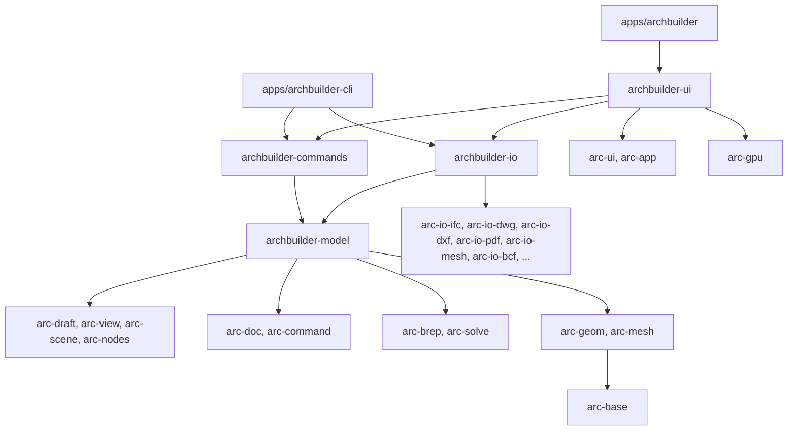

# ArchBuilder

> **Status: design phase.** No builds are available yet. This repository contains the product definition, architecture and roadmap that implementation follows.

ArchBuilder is an open-source building information modeling application for architecture,
structure and building services, written in Rust as part of the Arc suite. One semantic model per
document holds the project, its sites, buildings and storeys, and every element with its family,
type and parameters; plans, sections, elevations, 3D views, schedules, sheets and exchange files are
derived from that model. It runs natively on Windows, macOS and Linux, works fully offline without an
account, and treats IFC 4.3, IDS and BCF as first-class.

## Who it is for

Architects and architectural technologists, interior designers, structural engineers and detailers,
building-services engineers, BIM coordinators, owners receiving handover data, and computational
designers who automate models. See [the vision](docs/product/vision.md).

## Capability areas

| Area | Scope | Specification |
|---|---|---|
| Project setup and datum | Templates, spatial structure, units, levels, grids, coordinates, modify tools, model health | [01](docs/product/capabilities/01-project-setup-and-datum.md) |
| Walls and curtain systems | Layered and stacked walls, joins, curtain walls and systems | [02](docs/product/capabilities/02-walls-and-curtain-systems.md) |
| Doors, windows and openings | Hosted inserts, opening recipes, openings, components | [03](docs/product/capabilities/03-doors-windows-and-openings.md) |
| Floors, roofs and ceilings | Floors, roofs, roof edges, dormers, ceilings | [04](docs/product/capabilities/04-floors-roofs-and-ceilings.md) |
| Circulation | Stairs, ramps, railings, elevators | [05](docs/product/capabilities/05-circulation.md) |
| Rooms, areas and spaces | Rooms, area plans, programs, color schemes, zones | [06](docs/product/capabilities/06-rooms-areas-and-spaces.md) |
| Site and context | Terrain, pads, property lines, GIS and civil context | [07](docs/product/capabilities/07-site-and-context.md) |
| Families and family editor | Family kinds, editor, recipes, libraries, versions | [08](docs/product/capabilities/08-families-and-family-editor.md) |
| Parameters and constraints | Typed parameters, expressions, numbering, classification, constraints | [09](docs/product/capabilities/09-parameters-and-constraints.md) |
| Views and graphics | View kinds, visibility, templates, materials, navigation | [10](docs/product/capabilities/10-views-and-graphics.md) |
| Annotation, detailing and detached drawings | Dimensions, tags, detail layers, drafting views, detached drawings | [11](docs/product/capabilities/11-annotation-detailing-and-drawings.md) |
| Schedules and quantities | Schedules, quantity rules, takeoffs, carbon, cost | [12](docs/product/capabilities/12-schedules-and-quantities.md) |
| Sheets and publishing | Sheets, revisions, PDF, DWG, DXF, Hub publishing | [13](docs/product/capabilities/13-sheets-and-publishing.md) |
| Phases, options, groups and assemblies | Phasing, design options, model groups, assemblies, parts | [14](docs/product/capabilities/14-phases-options-groups-and-assemblies.md) |
| Links and coordination | Links, underlays, monitored elements, interference, BCF | [15](docs/product/capabilities/15-links-and-coordination.md) |
| Collaboration | Hub versions, comparison, branches, multi-user editing | [16](docs/product/capabilities/16-collaboration.md) |
| Visualization | Viewport, sun, cameras, rendering through RenderBuilder | [17](docs/product/capabilities/17-visualization.md) |
| Automation and extensibility | Commands, protocol, CLI, node graphs, plug-ins, checks | [18](docs/product/capabilities/18-automation-and-extensibility.md) |
| Interoperability | Native document, IFC, IDS, DWG, meshes, exchange package, loss reports | [19](docs/product/capabilities/19-interoperability.md) |
| Structural modeling | Columns, framing, foundations, structural walls and floors | [20](docs/product/capabilities/20-structural-modeling.md) |
| Reinforcement | Reinforcement modeling and schedules | [21](docs/product/capabilities/21-reinforcement.md) |
| Steel detailing | Connections, numbering, shop drawings, fabrication output | [22](docs/product/capabilities/22-steel-detailing.md) |
| Analytical model | Analytical members, loads, analysis exchange | [23](docs/product/capabilities/23-analytical-model.md) |
| HVAC | Service spaces, loads, ducts, sizing | [24](docs/product/capabilities/24-hvac.md) |
| Piping and plumbing | Pipe systems, fixtures, sizing | [25](docs/product/capabilities/25-piping-and-plumbing.md) |
| Electrical | Circuits, panels, devices, cable containment | [26](docs/product/capabilities/26-electrical.md) |
| Fabrication detailing | Services fabrication parts and output | [27](docs/product/capabilities/27-fabrication-detailing.md) |
| Concept massing | Masses, mass floors, divided surfaces | [28](docs/product/capabilities/28-concept-massing.md) |
| Building performance analysis | Solar, energy, daylight, wind, carbon | [29](docs/product/capabilities/29-building-performance-analysis.md) |
| Application connectors | Exchange with native project and family files of other applications | [30](docs/product/capabilities/30-application-connectors.md) |
| Web and tablet | Browser and tablet builds, touch and pen massing, on-site review | [31](docs/product/capabilities/31-web-and-tablet.md) |
| Assistance | Optional assistance: model questions, documentation proposals, rule findings, clash triage, layout and massing options | [32](docs/product/capabilities/32-assistance.md) |

## How it fits in the suite

ArchBuilder builds on [`arc-core`](https://github.com/ACKaraca/arc-core) and depends on no other
product at compile time. It cooperates with other products through the three suite contracts:

- **Arc document package:** `.archb` documents and `.archbfam` family packages, readable without
  ArchBuilder.
- **Arc Scene:** photoreal rendering in RenderBuilder and scene work in MeshBuilder.
- **Hub API:** versions, locks, issues, packages and multi-user change sets through Arc Hub.

It shares the drafting and sheet engine with DraftBuilder, exchanges terrain with CivilBuilder
through LandXML and IFC 4.3, and sends federations and BCF issues to Arc Review.

## Architecture at a glance

Details are in the [architecture overview](docs/architecture/overview.md).

## Roadmap summary

| Milestone | Suite phase | Theme |
|---|---|---|
| M1 | 2 | Model core: datum, walls, openings, floors, roofs, stairs, families, plans and 3D |
| M2 | 2 | Documentation and exchange: views, annotation, schedules, sheets, IFC; first production release |
| M3 | 3 | Coordination, phases, options, site, links, BCF, IDS, file-level Hub collaboration, first assistance |
| M4 | 4 | Structure, building services, concept massing, photoreal visualization |
| M5 | 5 | Multi-user editing, branch and merge, fabrication depth, assistant workflows |

See [the roadmap](docs/roadmap.md).

## Documentation

The [documentation map](docs/README.md) lists every document. Start with
[the vision](docs/product/vision.md), then [the capability index](docs/product/capabilities/README.md)
and [the architecture overview](docs/architecture/overview.md).

## Contributing

Read [CONTRIBUTING.md](CONTRIBUTING.md). Automated coding agents follow [AGENTS.md](AGENTS.md).
Report security issues as described in [SECURITY.md](SECURITY.md).

## License

Apache License 2.0; see [LICENSE](LICENSE) and [NOTICE](NOTICE).

## Trademarks

Arc, ArchBuilder, DraftBuilder, CivilBuilder, SolidBuilder, MeshBuilder, RenderBuilder, Arc Review and Arc Hub are names of this project and are not covered by the Apache License; see the [trademark policy](https://github.com/ACKaraca/arc-suite/blob/main/TRADEMARKS.md). All other product and company names are trademarks of their respective owners and are used only to describe scope and interoperability.
