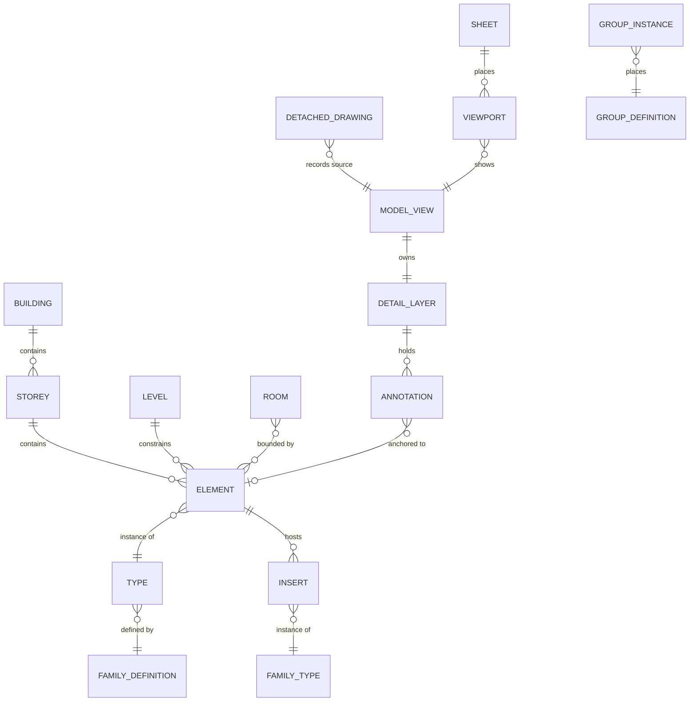

# Domain model

This document defines the object types of an ArchBuilder document, their key properties and
relationships, the invariants every committed revision satisfies, identity rules, and what
recomputes when something changes. It is the schema contract for `archbuilder-model`.

## Storage principles

- Every object is a typed record in an `arc-doc` object table with a stable 128-bit identifier and a
  per-table payload schema version.
- Records store **authored data only**. Geometry, joins, room areas, view drawings, schedule rows
  and quantities are derived and never stored as authority. Caches may be stored in the package for
  speed, keyed by revision, and are discarded when stale.
- Lengths are meters, angles radians, model space is right-handed with Z up. Values are typed
  quantities; display units apply only at the interface.
- References between records are by identifier. A reference to a missing record is invalid except
  where a state field explicitly allows it (orphaned annotations, unresolved links).

## Object catalog

### Project, spatial and datum objects

| Type | Key properties | Relationships |
|---|---|---|
| `Project` | Information fields, settings, units, boundary rule, template flag | One per document; root of spatial tree |
| `CoordinateRecord` | Base point, survey point, true north, CRS, map conversion, precision distance | One per document |
| `Site` | Name, boundary, terrain references | Child of project |
| `Building` | Name, elevation, address | Child of site |
| `Storey` | Name, level reference | Child of building; contains elements |
| `Level` | Name, elevation, elevation base, storey flag | Belongs to a building; referenced by constraints and views |
| `Grid` | Label, curve segments, extents | Belongs to a building or the site |
| `ReferencePlane` | Name, plane, bounds, strength | Belongs to a storey, family or view |
| `DatumExtentVolume` | Name, box | Assigned to datums and views |

### Physical elements

All physical elements share: `id`, `category`, `type_id` (where applicable), `storey_id`,
`created_phase`, `demolished_phase`, `option_id`, `group_member_of`, `work_area`, `parameters`,
`classification`, `ifc_mapping_override`, `pinned`.

| Type | Key properties | Relationships |
|---|---|---|
| `Wall` | Location curve, location line, base and top constraints, profile override, cross-section, flip, function, structural usage, room-bounding, roof binding, band overrides | Type `WallType`; hosts `Insert`, `Opening`; joins via derived `Join` |
| `CurtainWall` | Location curve, constraints, grid rule overrides, manual grid lines, cell map (cell key to panel type) | Type `CurtainWallType`; owns `CurtainGridLine`, `Mullion`, `CurtainPanel` |
| `Floor`, `Ceiling` | Boundary profile, level, offset, slope, shape points, pattern origin | Types `FloorType`, `CeilingType`; host inserts and edges |
| `Roof` | Footprint or extrusion profile, per-edge slope, pitch, overhang, courtyard flags, base level | Type `RoofType`; owns `Dormer` children; hosts edges and inserts |
| `Dormer` | Host roof, placement, dimensions, owned wall IDs, owned opening ID | Reconciles its children |
| `EdgeElement` | Kind, profile, host edge references | Hosted by floor or roof edges |
| `Insert` | Family type, host, host-local position, height, hand, facing | Hosted by a wall, floor, ceiling, roof or face |
| `Opening` | Kind, profile, constraints, hosts (derived for shafts) | Cuts hosts; may be owned by a stair |
| `Component` | Family type, placement, mirror, work plane | Freestanding |
| `Stair`, `Ramp` | Constraints, runs, landings, supports, repeat members | Types; own railings and openings |
| `Railing` | Path, host | Type `RailingType` |
| `ElevatorAssembly` | Cabin type, served levels, part map | Owns walls and doors |
| `TerrainSolid`, `Pad`, `PropertyLine` | Points or TIN, boundaries, setbacks | Site children |
| `StructuralColumn`, `Framing`, `Foundation`, `BeamSystem`, `Truss` | Section, material, axis, end offsets, usage | Analytical counterparts; hosts for reinforcement and connections |
| `Reinforcement` | Shape, set layout, host, cover | Hosted by a concrete element |
| `SteelPart`, `Connection`, `Fastener`, `Weld` | Geometry, profile, grade, parent parts, connection parameters | Steel assemblies; numbering |
| `AnalyticalMember`, `AnalyticalPanel`, `Load`, `BoundaryCondition` | Analytical geometry, releases, load cases | Associated with physical elements |
| `ServiceSegment`, `ServiceFitting`, `ServiceEquipment`, `ServiceSystem`, `ServiceSpace` | Size, route, connectors, system classification, flow | Systems connect through `Connector` records of family instances |
| `Mass`, `MassFloor`, `DividedSurface` | Forms, levels, UV grids | Faces referenced by face-based walls, roofs and curtain systems |

#### The wall of the first slice

The first implemented `Wall` is a reduced record, `archbuilder.wall`, owned by its storey (the wall
stands on the storey's level; the storey must exist). It stores authored data only, lengths in
meters:

| Field | Meaning | Rule |
|---|---|---|
| `name` | Unique within the storey, `Wall <n>` by default | Not blank |
| `start_x`, `start_y`, `end_x`, `end_y` | The baseline's two points, project coordinates | Within 100 km of the origin; the baseline is at least 1 mm long |
| `thickness` | Distance between the two faces | 1 mm to 5 m; 0.2 m by default |
| `height` | Height above the base of an unconnected wall; the fallback of a constrained one | 10 mm to 1000 m; 3 m by default |
| `top_level` | The level the top is constrained to; absent for an unconnected wall | Optional reference to a level, cleared when the level is deleted; by default the level of the next higher storey, when there is one |
| `base_offset` | The base's distance above the storey's level | -1000 m to 1000 m; 0 by default |
| `start_join`, `end_join` | How each end joins: `auto`, `butt`, `square` or `disallowed` (schema 1.1; absent in older files, read as `auto`) | `auto` by default; the only authored part of a join |
| `location_line` | Which line of the wall the baseline is: `center`, `exterior` (the exterior face) or `interior` (the interior face) | `center` by default; changing it keeps the wall's physical position: the stored baseline moves across by the difference of the offsets |

The solid is derived, never stored: a prism over the rectangle of the baseline and the thickness,
from the storey's level elevation plus the base offset, up by the height. With a `top_level` the
height is derived: that level's elevation minus the base, so raising the level raises the wall; a
level that is not above the base is refused. Setting the height of a wall, or giving one when it is
created, leaves it unconnected. The side of a wall is
named from the baseline's direction: the face on the left of the direction from the start point to
the end point is the exterior face, the right one the interior face, so `exterior` puts the body to
the right of the baseline and `interior` to the left. Faces keep their identity through the solid
kernel's face tags (`Side` of the footprint loop: the exterior face is curve 2 and the interior
face is curve 0 of the loop that runs start-right, end-right, end-left, start-left; the two ends
are curves 1 and 3; the caps are `Top` and `Bottom`).

Joins are derived, never stored: when the solids are made, the walls of a storey are read
together and each wall's footprint gets its ends closed against the walls it meets. Only the
per-end style above is authored. Walls whose ends coincide (within 0.1 mm) form a node: two walls
miter, three or four close a star, two collinear walls with equal faces meet flush, and a straight
run through a node lets the others stop at its face. An end on the interior of another wall's
baseline is a T and stops at that wall's near face without entering it. All rules use the faces
(the location line and thickness decide where they are), so walls of different thickness and
location line close without gap or overlap. `butt` and `square` make a corner of two walls run
one wall through (this end stops at the other's face; `square` cuts it square), and the style of
the other end decides which wall runs through; both ends butt cancel into the miter. `disallowed`
takes the end out of every join (square end, overlap allowed). A corner that would reach more
than two thicknesses past the end, or past the middle of the wall, is refused and the ends of
that node stay square; the volume, the property grid and `inspect` use the joined solid, so a
closed rectangle counts each corner once. The viewport extracts the walls of a storey again when
any of them is created, changed or deleted.

Known limits: walls have no constraints, types, layers or curves, and the only inserts are the doors and windows below; a wall that
crosses another without ending on it is not joined; a node of three or more walls without a
straight run (a Y) leaves a small notch at its center; styles other than `auto` apply only at a
corner of two walls and at a T. The viewport extracts a wall again when its storey or the level of its storey changes. A storey
that has walls cannot be deleted; the walls are never deleted with it. `archbuilder.wall.flip` moves a wall's body to the other side of its location line (the
baseline stays; a center line has no side), and `archbuilder.wall.delete`
deletes walls (the named ones, else the selected ones) in one transaction, so one undo restores
them; `archbuilder.object.delete`, the Delete key, deletes the selected walls, else the selected
storey.

#### The door and window of the first slice

The first implemented `Insert` kinds are two reduced records, `archbuilder.door` and
`archbuilder.window`, built-in parametric kinds rather than loadable families. The host wall is the
header owner, so an insert is contained in its wall: deleting the wall deletes its inserts in the
same transaction (the command result and the application name how many), and one undo brings wall and
inserts back. Authored data only, lengths in meters, one layout for both kinds:

| Field | Meaning | Rule |
|---|---|---|
| `name` | Unique among the doors (or windows) of the wall, `Door <n>` or `Window <n>` by default | Not blank |
| `distance` | From the baseline's start to the center of the opening | 0 to 100 km; the opening lies in the clear span (below) |
| `width`, `height` | Size of the opening | 0.1 m to 20 m; 0.9 by 2.1 m for a door, 1.2 by 1.2 m for a window by default |
| `sill` | Bottom of the opening above the wall's base | 0 to 100 m; 0 for a door, 0.9 m for a window by default; the head stays 10 mm below the wall's top |
| `frame_width`, `frame_depth` | Width of the four frame bars, depth across the wall (never more than the thickness) | 10 mm to 0.5 m and 10 mm to 2 m; 50 mm and 100 mm by default; the frame leaves at least 20 mm clear |
| `operation` | `single_swing` for a door; `fixed` or `casement` for a window | The kind decides what is allowed |
| `hand` | `left` or `right`: the hinge side seen from the side the leaf swings toward | `left` by default |
| `facing` | `exterior` or `interior`: the side of the wall the leaf swings toward | `exterior` by default |

Rules: the opening, with 10 mm of clearance, lies in the wall's clear span, the stretch of the
baseline where the joined solid has both faces, so an insert cannot reach into a mitered corner or
a T (a wall that would be created, joined or shortened over an insert is refused with the insert named; an opening may not open into the body of another wall that meets or crosses its wall,
as is a level that moves a wall's top below one); two inserts of a wall keep 10 mm between their
openings at any height; at most 1000 inserts stand in a wall. Moving a wall keeps its inserts at their
distance along it; `archbuilder.wall.flip` reverses the baseline, so it also sets each distance to the
wall's length minus the distance and flips each facing, which keeps every insert where it is and swinging
the same way in the room.

IFC mapping as implemented (`archbuilder-io`, IFC4, lengths in meters, every `GlobalId` from the
object's identifier): a wall maps to `IfcWall`, contained in the `IfcBuildingStorey` of its storey and
placed on the storey with its origin at the baseline's start, base offset up and the x axis along the
baseline. Its body is the extrusion of the joined footprint by the derived height (the corners the
joins give, so the volume is the one of `inspect`). `Qto_WallBaseQuantities` holds `Length` (baseline),
`Width`, `Height`, `GrossVolume` (the joined prism) and `NetVolume` (the volume with the openings
cut, the same rule as the property grid). The wall type is `NOTDEFINED` and no `Pset_WallCommon` is
written: the model has no external flag, and writing `IsExternal` either way would state what is not
known. Each door or window maps to an `IfcOpeningElement` (identifier derived from the insert's with
the role `INSERT_OPENING`) that voids the wall and is filled by an `IfcDoor` or `IfcWindow`, both
placed at the center of the opening at the sill. The opening's body is the prism of the width and the
height through the wall's thickness. The insert's body is one faceted B-rep of the frame bars and the
leaf or pane (and a door's handle), the same solids the viewport draws; they are separate closed
solids in one shell. The insert's placement has its y axis toward the side a door swings to, so a
door's `OperationType` follows the hinge: the product reads a door's hand facing the leaf from the side it swings toward, IFC4 reads it looking along the placement's y axis (the swing direction), the opposite viewpoint. A product `left` door has its hinge at +x and is `SINGLE_SWING_RIGHT`; a `right` door has its hinge at -x and is `SINGLE_SWING_LEFT`; windows are `SINGLE_PANEL`. IFC4 has no operation on the window itself, so the operation,
hand and facing of a casement window are reported as approximated and a fixed window loses nothing.
`OverallWidth` and `OverallHeight` come from `width` and `height`.

Derived, never stored: the wall's solid is the joined solid with each opening cut through its whole
thickness by the foundation's prism subtraction (the volume of the property grid and `inspect` is that
net volume); the insert's own solids are the four bars of the frame, the closed leaf (door, with a
handle opposite the hinge on the facing side) or the glass pane (window), drawn in their own colors.
`archbuilder.door.place` and `archbuilder.window.place` place one insert (a click on a wall, or a
typed distance along the selected wall; the options width, height, sill, hand and facing; chains
continue until Enter or Escape, one undo step each), `archbuilder.insert.flip_hand` and
`archbuilder.insert.flip_facing` flip the selected ones, and `archbuilder.object.delete` deletes the selected
inserts. Known limits: no types or families, no room relations,
arched or non-rectangular openings and double leaves are not offered. The plan symbol (the opening across the wall, a door's open leaf with its swing arc, a window's frame and glass line) is drawn as a viewport overlay at a cut 1 m above the wall's base, and an insert is picked from its opening in plan and in 3D ahead of its wall.

#### The floor of the first slice

The first implemented `Floor` is a reduced record, `archbuilder.floor`, owned by its storey (a
storey that has floors cannot be deleted). It has no type, layers, slope or shape points yet.

| Field | Meaning | Rule |
|---|---|---|
| `name` | Unique within the storey, `Slab <n>` by default | Not blank |
| `thickness` | The slab's thickness; the slab hangs down from its top | 1 mm to 5 m; 0.2 m by default |
| `top_offset` | The top's distance above the storey's level | -1000 m to 1000 m; 0 by default |
| `vertices` | The boundary: the outer loop, then the holes, each loop in order, straight edges only. Each vertex is a record of the loop number (0 outer), the authored point, and the optional association of the edge that starts there: `wall` (reference, cleared when the wall is deleted), `face` (`interior`, `exterior` or `center`) and `offset` | At most 1000 vertices and 64 loops |

An edge associated with a wall lies on the line of the chosen face of that wall (the center face is
the wall's center line, the core center once walls have layers), moved by the offset; a vertex that
touches an associated edge is the meeting point of the lines of its two edges, so the floor follows
a wall that moves or changes thickness. The interior and exterior faces are the ones that look into
and away from the enclosed area, whichever way the wall was drawn. A free edge lies on the line
through its two authored points. Deleting a wall (`archbuilder.wall.delete`,
`archbuilder.object.delete`) first freezes the edges that followed it: they keep their last derived
position, lose the association, and the command result and the window report how many (undo restores
both). Rules, checked on every commit that touches the floor or a wall of its storey: each loop is
simple (no crossing, touching or fold-back), no edge is shorter than 1 mm, the outer loop has an
area of at least 1 cm², holes lie inside the outer loop and apart from each other.

`archbuilder.floor.create` takes `points` (with optional `holes`), `walls` (a closed chain in order)
or `picks` (points: each on a wall picks it; a single point inside a closed loop of joined walls,
including walls that end on other walls, picks the smallest loop around it), with `face`,
`thickness` and `offset`. `archbuilder.floor.add_hole` cuts a hole from a sketched loop. The
property grid edits `thickness` and `top_offset` through `archbuilder.property.set` and shows the
storey, the area, the volume and the associated walls; `inspect` lists each floor with the same
numbers. Derived, never stored: the boundary, the area (outer loop minus holes), the volume (area
times thickness) and the solid, a prism of the boundary from the top down by the thickness.

## Selection and modify commands

Selection is the tab's transient state, never an undo step. A click selects, Shift adds, Ctrl toggles
(removes an object already selected); a window dragged left to right takes the objects that lie
fully inside, a crossing dragged right to left those it touches, with the same modifiers; Escape
clears. A band that takes a wall also takes the doors and windows in it. The property grid shows the
fields the selected objects share and "(mixed)" where their values differ; one edit applies to all
of them as one undo step.

`archbuilder.modify.move`, `copy`, `rotate` and `mirror` (rotate's `angle`: a JSON number is radians, a text with a unit such as `"90 deg"` says its own, a bare text number is degrees; typed `m`, `co`, `ro`, `mi`, or the
Turkish `taşı`, `kopyala`, `döndür`, `aynala`) work on the selection, or ask for objects first and
take the selection on Enter. Each run is one transaction. Walls move by their baselines and their
joins re-derive. A wall outside the selection whose end met a moved wall (at its end or on its
baseline) stretches or shrinks along its own line to the moved wall's new line in the same
transaction, and the moved wall's own end goes to the same corner point, and its doors and windows keep their place; a moved wall whose end stood on another
wall slides along it. A join that cannot be kept (parallel lines, a corner more than 100 lengths
away) is left open and named in the command line. Doors and windows follow their host wall; one
that would now open into another wall is allowed with a warning. `inspect --check` and the
validator warn of an open corner (two wall ends within 0.5 m, not joined) and of a floor edge that
runs past the wall it follows. A copy makes new walls (with their doors and windows), floors and inserts
with new identifiers and the next free names, and selects them; copy repeats from one base point
until Enter. A reflection stores a mirrored wall with its baseline reversed, so its exterior face
stays exterior, and swaps the hand of its doors and windows. A floor keeps an edge associated with a
wall only when that wall moves or is copied with it; every other edge is dissociated and stays
where the motion puts it (the result and a notice say how many). A door or window moved alone slides
along its wall by the displacement projected onto the baseline and is refused outside the clear span
or on another opening; rotating or mirroring one alone is refused. Storeys and levels are skipped.

Walls and floors in this slice: a floor by interior faces sits between the walls; a floor by exterior
faces overlaps the wall bottoms by the slab thickness. Wall volumes are not reduced and the floor
volume is the full prism. A wall whose base is on the storey's level is not cut by the floor, and
join cleanup between floors and walls is not done yet. Known limits: no arcs, layers, slope or shape
editing; consecutive walls that are parallel but not collinear do not make a boundary; a dead-end
wall inside a room is skipped when picking a loop by click. Collinear neighbors (a wall split in
two) make one straight edge, each part following its wall; their vertex stays at its authored
position along the line. `archbuilder.wall.flip` keeps every floor edge where it is: the following
associations swap face and offset in the same transaction. A refused finish keeps the sketch or the
picks in the tool. Escape steps out one level at a time: the first cancels only the segment that
follows the pointer and keeps the placed points (`undo` still removes the last), the second discards
the sketch or the picks and asks again, the third ends the tool.

IFC mapping as implemented: a floor maps to `IfcSlab` with `PredefinedType` `FLOOR`, contained in the
`IfcBuildingStorey` of its storey. Its body is an extruded area solid of the boundary (the holes as
inner curves) hanging from the top: the profile lies at the storey's level plus `top_offset` and the
extrusion runs down by the thickness. `Qto_SlabBaseQuantities` holds `Width` (the thickness),
`GrossArea` and `GrossVolume` (the outer loop alone), `NetArea` and `NetVolume` (holes taken out,
the rule of `inspect`).

Export: `archbuilder-io` writes the first building of the document with `arc-io-ifc`; `export_ifc`
takes a snapshot and the caller's file name and time stamp (no clock in the crate) and returns the
bytes, the number of walls, floors, doors and windows, and a loss report (`archbuilder-cli
export-ifc <file.archb> <out.ifc> [--timestamp ISO8601]` prints it). Objects that cannot be read, a
body that cannot be made, a left-out quantity and the casement window operation are report items;
other buildings are reported as not exported. The command `archbuilder.file.export_ifc path=<file>`
is File > Export > IFC. Started without a path (the menu entry, or the typed command), it opens a
save dialog for IFC files that starts with the document's name, then runs with the chosen file. A
relative path resolves against the folder of the saved document, else the documents or home folder.
When no file dialog opens or the user cancels, the history says that no file was chosen and the
typed form with a path still works.

### Types and families

| Type | Key properties | Relationships |
|---|---|---|
| `WallType`, `FloorType`, `RoofType`, `CeilingType` | Layers (function, material, thickness, variable, wrap), core boundary, bands | Referenced by elements |
| `CurtainWallType` | Grid rules, panel and mullion types, join priority | Referenced by curtain walls and glazed roofs |
| `StairType`, `RampType`, `RailingType` | Rules and component types | Referenced by circulation elements |
| `FamilyDefinition` | Stable family ID, version, category, hosting, parameters, recipes, nested uses | Pinned definition; see [families.md](families.md) |
| `FamilyType` | Family ID, name, parameter values | Referenced by inserts, components, annotation |
| `Material` | Graphics, appearance, physical, thermal, carbon, identity | Referenced by layers and slots |

### Spaces, data and organization

| Type | Key properties | Relationships |
|---|---|---|
| `Room` | Seed or profile, level, limits, data | Derived boundary from bounding elements |
| `SeparationLine` | Curve, level, kind (room or area) | Room or area boundary input |
| `AreaScheme`, `Area`, `AreaBoundary` | Scheme rules, area types with counting flag or factor | Area plans; counted areas feed development ratios |
| `Zone` | Kind, member rooms | Rooms |
| `ClearanceZone` | Source (family declaration, insert operation, user), shape, height | Diagnostic; never in quantities or exports |
| `RoomRuleTable`, `RequirementTable`, `DevelopmentLimits` | Rows by use and basis, limits, source and edition | Compared with rooms, area schemes and provided counts |
| `WorkItemCatalog`, `WorkItemMapping` | Item code, unit, measurement rule, rate; mapping from types, layers and materials | Feed bills of quantities through the quantity rules |
| `UnitLibraryEntry` | Identity, version, group content, placement rules, derived descriptors | Stored in library packages and immutable per version; a group definition placed from it records its identity and version |
| `ParameterDefinition`, `ParameterBinding` | Stable ID, data type, scope, categories | Values on elements and types |
| `DocumentVariable` | Name, value or expression | Drives parameters |
| `Constraint` | Kind, references (persistent references), value | Solved in transactions |
| `Phase`, `PhaseDisplayRule` | Order, status display | Elements, views |
| `OptionSet`, `DesignOption` | Primary flag | Elements |
| `GroupDefinition`, `GroupInstance` | Members, frame, level mapping, exceptions, identity map | Members are ordinary records flagged with `group_member_of` |
| `Assembly`, `Part` | Members, source layer, divisions | Derived from elements |
| `Link`, `LinkInstance`, `MonitoredElement`, `CoordinationItem` | Source, hash, position, state | External references through `arc-doc` |
| `Issue` | BCF topic, viewpoints, references | Hub synchronized |
| `Warning` | Rule, severity, element IDs | Derived; persisted for history |

### Views and documentation

| Type | Key properties | Relationships |
|---|---|---|
| `ModelView` | Kind, definition (range, plane, camera), scale, detail level, style, phase, template, parent | Owns one `DetailLayer`; see [views-and-documentation.md](views-and-documentation.md) |
| `ViewTemplate`, `ViewFilter` | Controlled properties, rule tree | Bound by views |
| `DetailLayer` | Drafting entities, annotations | Owned by one model view |
| `Annotation` | Kind, anchors, style, overrides, state | Owned by a detail layer, drafting view or sheet |
| `DraftingView`, `DetachedDrawing` | Drafting document; for detached: source view and revision, copied detail IDs | Independent of the model |
| `Schedule` | Query, fields, formatting | Placed on sheets |
| `Sheet`, `Viewport`, `Revision`, `SheetSet` | Paper geometry, sources, numbering | Publishing |
| `ExchangeLink` | Package location, mapping table, last exchanged state with per-entry hashes, exchange identifiers | Persistent per document; drives change detection in [30-application-connectors.md](../product/capabilities/30-application-connectors.md) |

## Identity rules

1. Every record has a 128-bit identifier assigned at creation and never changed. Editing, moving
   between storeys, changing type and undo do not change it.
2. Copy, array, group placement and paste allocate new identifiers; group instances keep an
   identity map from definition member to instance member.
3. Generated children (curtain panels, mullions, dormer walls, repeated stairs, elevator parts,
   beam system members) have identifiers derived deterministically from the parent identifier and a
   stable child key (cell key, level ID, member index), so regeneration preserves them.
4. The IFC GlobalId of an element is derived from its identifier and stored in the identity map;
   repeated exports produce the same GlobalId.
5. Persistent references to faces and edges name the element, the generator's stable face role
   (for example `wall.exterior-finish`, `roof.cell[edge-id].top`) and, for split results, the source
   edge identifier. They are resolved after each regeneration; an unresolved reference is reported,
   never rebound by proximity.
6. Detached drawings copy geometry with new drafting identifiers and record the source view
   identifier and revision.
7. Imported elements record their source identifiers in the identity map so re-import updates in
   place.
8. Elements exchanged with another application through a connector also carry an exchange
   identifier, assigned once, never reused and never derived from the other application's
   identifiers ([ADR 0007](../adr/0007-exchange-identifiers.md)).

## Invariants

A transaction that would violate an invariant is rejected; the document is unchanged.

| Invariant | Applies to |
|---|---|
| Every element is contained in exactly one storey or the site, of the building whose levels it references | Physical elements |
| A top constraint is above its base, or the element uses an unconnected height greater than zero | Level-bound elements |
| Profiles are closed, non-self-intersecting, with holes inside the outer ring and no edge shorter than the model tolerance | Floors, ceilings, roofs, openings, rooms with profiles |
| A hosted insert lies within its host's solid and does not overlap another insert of the same host at the same height | Inserts |
| A demolished phase is not earlier than the created phase | Elements |
| An element belongs to the main model or to exactly one option; it cannot reference elements of another option in the same set | Design options |
| Group member records are edited only through their group definition | Group members |
| Generated children are edited only through their parent's commands | Curtain walls, dormers, repeated stairs, elevators, beam systems |
| A family instance's parameter values satisfy the family's validation rules and its pinned definition evaluates to valid solids | Family instances |
| Constraint sets are solvable | Constraints |
| Names are unique within their scope (level names per building, view names per document, sheet numbers per document) | Named records |
| Every viewport shows a view that exists; a model view appears on at most one sheet | Sheets |

## Name comparison

Names are stored exactly as entered. Comparing and searching names, including the uniqueness checks
above, uses Unicode case folding in which the four letters i, ı, İ and I form one equivalence class.
The comparison is independent of the interface language and of the machine's locale, so a document
behaves the same on every machine.

## Regeneration and dependency rules

The dependency graph is maintained by `arc-doc`. Nodes are element records and derived products;
edges are listed below. A change marks its dependents dirty; validity-relevant products recompute
inside the transaction, display products recompute on workers after commit.

| Change | Recomputes |
|---|---|
| Level elevation | Every element constrained to the level; their hosted inserts; rooms on affected storeys; views of affected storeys |
| Grid or reference plane | Elements constrained to it; constraint solve |
| Wall type layers | All walls of the type; their joins, hosted inserts' cuts, rooms bounded by them, material takeoffs |
| Wall location, constraint or profile | The wall, joined walls, attached floors and roofs edges associated with it, hosted inserts, rooms, area boundaries generated from it |
| Roof footprint, pitch or type | Roof face cells, attached and roof-bound walls, dormers, edge elements, hosted inserts |
| Insert parameters or position | The insert, its host cut, door room relations |
| Family definition update | All instances of its types; hosts they cut; tags reading changed parameters |
| Parameter value | Dependent expressions, document variables, constraints, tags, schedules, filters, color schemes |
| Room-bounding flag or room separation line | Rooms and areas on the level; volumes; finishes |
| Phase or option assignment | View visibility, rooms per phase, schedules |
| Group definition | Every instance's member records (as one transaction) |
| Link reload | Link display, monitored element coordination items, room boundaries from the link, linked annotations' anchors |
| Any element visible in a view | That view's drawing (projection, cut regions, hidden lines) on workers |
| View template | Every bound view's settings and drawing |
| Model change referenced by a sheet | Viewport contents; publication marks the sheet stale |

Rules:

1. A derived result carries the revision it was computed from and is discarded if the revision is no
   longer current.
2. Regeneration order follows the graph; cycles are rejected at commit (for example, a wall attached
   to a roof whose footprint is associated with that wall's exterior face is allowed because the
   footprint uses the wall's location, not its derived top).
3. Detached drawings and drafting views have no dependency edges into the model.
4. Annotation anchors in detail layers depend on their anchor element's derived geometry; an
   unresolved anchor sets the annotation state to orphaned without failing the transaction.
