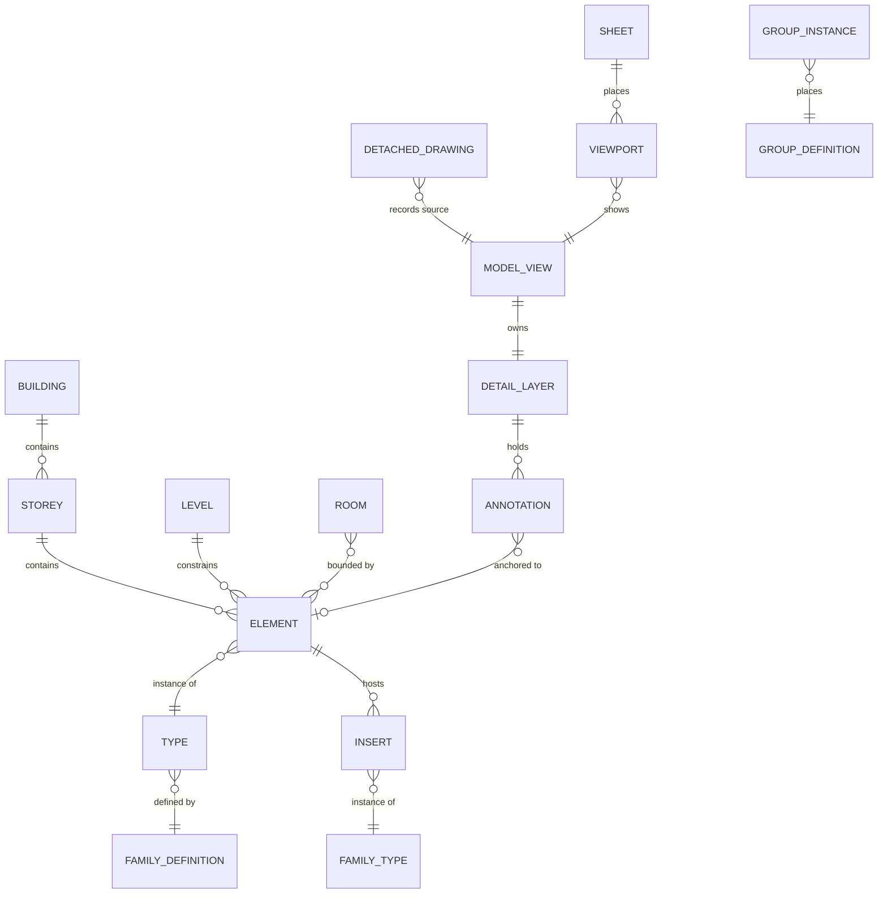

# Domain model

This document defines the object types of an ArchBuilder document, their key properties and
relationships, the invariants every committed revision satisfies, identity rules, and what
recomputes when something changes. It is the schema contract for `archbuilder-model`.

## Storage principles

- Every object is a typed record in an `arc-doc` object table with a stable 128-bit identifier and a
  per-table payload schema version.
- Records store **authored data only**. Geometry, joins, room areas, view drawings, schedule rows
  and quantities are derived and never stored as authority. Caches may be stored in the package for
  speed, keyed by revision, and are discarded when stale.
- Lengths are meters, angles radians, model space is right-handed with Z up. Values are typed
  quantities; display units apply only at the interface.
- References between records are by identifier. A reference to a missing record is invalid except
  where a state field explicitly allows it (orphaned annotations, unresolved links).

## Object catalog

### Project, spatial and datum objects

| Type | Key properties | Relationships |
|---|---|---|
| `Project` | Information fields, settings, units, boundary rule, template flag | One per document; root of spatial tree |
| `CoordinateRecord` | Base point, survey point, true north, CRS, map conversion, precision distance | One per document |
| `Site` | Name, boundary, terrain references | Child of project |
| `Building` | Name, elevation, address | Child of site |
| `Storey` | Name, level reference | Child of building; contains elements |
| `Level` | Name, elevation, elevation base, storey flag | Belongs to a building; referenced by constraints and views |
| `Grid` | Label, curve segments, extents | Belongs to a building or the site |
| `ReferencePlane` | Name, plane, bounds, strength | Belongs to a storey, family or view |
| `DatumExtentVolume` | Name, box | Assigned to datums and views |

### Physical elements

All physical elements share: `id`, `category`, `type_id` (where applicable), `storey_id`,
`created_phase`, `demolished_phase`, `option_id`, `group_member_of`, `work_area`, `parameters`,
`classification`, `ifc_mapping_override`, `pinned`.

| Type | Key properties | Relationships |
|---|---|---|
| `Wall` | Location curve, location line, base and top constraints, profile override, cross-section, flip, function, structural usage, room-bounding, roof binding, band overrides | Type `WallType`; hosts `Insert`, `Opening`; joins via derived `Join` |
| `CurtainWall` | Location curve, constraints, grid rule overrides, manual grid lines, cell map (cell key to panel type) | Type `CurtainWallType`; owns `CurtainGridLine`, `Mullion`, `CurtainPanel` |
| `Floor`, `Ceiling` | Boundary profile, level, offset, slope, shape points, pattern origin | Types `FloorType`, `CeilingType`; host inserts and edges |
| `Roof` | Footprint or extrusion profile, per-edge slope, pitch, overhang, courtyard flags, base level | Type `RoofType`; owns `Dormer` children; hosts edges and inserts |
| `Dormer` | Host roof, placement, dimensions, owned wall IDs, owned opening ID | Reconciles its children |
| `EdgeElement` | Kind, profile, host edge references | Hosted by floor or roof edges |
| `Insert` | Family type, host, host-local position, height, hand, facing | Hosted by a wall, floor, ceiling, roof or face |
| `Opening` | Kind, profile, constraints, hosts (derived for shafts) | Cuts hosts; may be owned by a stair |
| `Component` | Family type, placement, mirror, work plane | Freestanding |
| `Stair`, `Ramp` | Constraints, runs, landings, supports, repeat members | Types; own railings and openings |
| `Railing` | Path, host | Type `RailingType` |
| `ElevatorAssembly` | Cabin type, served levels, part map | Owns walls and doors |
| `TerrainSolid`, `Pad`, `PropertyLine` | Points or TIN, boundaries, setbacks | Site children |
| `StructuralColumn`, `Framing`, `Foundation`, `BeamSystem`, `Truss` | Section, material, axis, end offsets, usage | Analytical counterparts; hosts for reinforcement and connections |
| `Reinforcement` | Shape, set layout, host, cover | Hosted by a concrete element |
| `SteelPart`, `Connection`, `Fastener`, `Weld` | Geometry, profile, grade, parent parts, connection parameters | Steel assemblies; numbering |
| `AnalyticalMember`, `AnalyticalPanel`, `Load`, `BoundaryCondition` | Analytical geometry, releases, load cases | Associated with physical elements |
| `ServiceSegment`, `ServiceFitting`, `ServiceEquipment`, `ServiceSystem`, `ServiceSpace` | Size, route, connectors, system classification, flow | Systems connect through `Connector` records of family instances |
| `Mass`, `MassFloor`, `DividedSurface` | Forms, levels, UV grids | Faces referenced by face-based walls, roofs and curtain systems |

### Types and families

| Type | Key properties | Relationships |
|---|---|---|
| `WallType`, `FloorType`, `RoofType`, `CeilingType` | Layers (function, material, thickness, variable, wrap), core boundary, bands | Referenced by elements |
| `CurtainWallType` | Grid rules, panel and mullion types, join priority | Referenced by curtain walls and glazed roofs |
| `StairType`, `RampType`, `RailingType` | Rules and component types | Referenced by circulation elements |
| `FamilyDefinition` | Stable family ID, version, category, hosting, parameters, recipes, nested uses | Pinned definition; see [families.md](families.md) |
| `FamilyType` | Family ID, name, parameter values | Referenced by inserts, components, annotation |
| `Material` | Graphics, appearance, physical, thermal, carbon, identity | Referenced by layers and slots |

### Spaces, data and organization

| Type | Key properties | Relationships |
|---|---|---|
| `Room` | Seed or profile, level, limits, data | Derived boundary from bounding elements |
| `SeparationLine` | Curve, level, kind (room or area) | Room or area boundary input |
| `AreaScheme`, `Area`, `AreaBoundary` | Scheme rules, area types with counting flag or factor | Area plans; counted areas feed development ratios |
| `Zone` | Kind, member rooms | Rooms |
| `ClearanceZone` | Source (family declaration, insert operation, user), shape, height | Diagnostic; never in quantities or exports |
| `RoomRuleTable`, `RequirementTable`, `DevelopmentLimits` | Rows by use and basis, limits, source and edition | Compared with rooms, area schemes and provided counts |
| `WorkItemCatalog`, `WorkItemMapping` | Item code, unit, measurement rule, rate; mapping from types, layers and materials | Feed bills of quantities through the quantity rules |
| `UnitLibraryEntry` | Identity, version, group content, placement rules, derived descriptors | Stored in library packages and immutable per version; a group definition placed from it records its identity and version |
| `ParameterDefinition`, `ParameterBinding` | Stable ID, data type, scope, categories | Values on elements and types |
| `DocumentVariable` | Name, value or expression | Drives parameters |
| `Constraint` | Kind, references (persistent references), value | Solved in transactions |
| `Phase`, `PhaseDisplayRule` | Order, status display | Elements, views |
| `OptionSet`, `DesignOption` | Primary flag | Elements |
| `GroupDefinition`, `GroupInstance` | Members, frame, level mapping, exceptions, identity map | Members are ordinary records flagged with `group_member_of` |
| `Assembly`, `Part` | Members, source layer, divisions | Derived from elements |
| `Link`, `LinkInstance`, `MonitoredElement`, `CoordinationItem` | Source, hash, position, state | External references through `arc-doc` |
| `Issue` | BCF topic, viewpoints, references | Hub synchronized |
| `Warning` | Rule, severity, element IDs | Derived; persisted for history |

### Views and documentation

| Type | Key properties | Relationships |
|---|---|---|
| `ModelView` | Kind, definition (range, plane, camera), scale, detail level, style, phase, template, parent | Owns one `DetailLayer`; see [views-and-documentation.md](views-and-documentation.md) |
| `ViewTemplate`, `ViewFilter` | Controlled properties, rule tree | Bound by views |
| `DetailLayer` | Drafting entities, annotations | Owned by one model view |
| `Annotation` | Kind, anchors, style, overrides, state | Owned by a detail layer, drafting view or sheet |
| `DraftingView`, `DetachedDrawing` | Drafting document; for detached: source view and revision, copied detail IDs | Independent of the model |
| `Schedule` | Query, fields, formatting | Placed on sheets |
| `Sheet`, `Viewport`, `Revision`, `SheetSet` | Paper geometry, sources, numbering | Publishing |
| `ExchangeLink` | Package location, mapping table, last exchanged state with per-entry hashes, exchange identifiers | Persistent per document; drives change detection in [30-application-connectors.md](../product/capabilities/30-application-connectors.md) |

## Identity rules

1. Every record has a 128-bit identifier assigned at creation and never changed. Editing, moving
   between storeys, changing type and undo do not change it.
2. Copy, array, group placement and paste allocate new identifiers; group instances keep an
   identity map from definition member to instance member.
3. Generated children (curtain panels, mullions, dormer walls, repeated stairs, elevator parts,
   beam system members) have identifiers derived deterministically from the parent identifier and a
   stable child key (cell key, level ID, member index), so regeneration preserves them.
4. The IFC GlobalId of an element is derived from its identifier and stored in the identity map;
   repeated exports produce the same GlobalId.
5. Persistent references to faces and edges name the element, the generator's stable face role
   (for example `wall.exterior-finish`, `roof.cell[edge-id].top`) and, for split results, the source
   edge identifier. They are resolved after each regeneration; an unresolved reference is reported,
   never rebound by proximity.
6. Detached drawings copy geometry with new drafting identifiers and record the source view
   identifier and revision.
7. Imported elements record their source identifiers in the identity map so re-import updates in
   place.
8. Elements exchanged with another application through a connector also carry an exchange
   identifier, assigned once, never reused and never derived from the other application's
   identifiers ([ADR 0007](../adr/0007-exchange-identifiers.md)).

## Invariants

A transaction that would violate an invariant is rejected; the document is unchanged.

| Invariant | Applies to |
|---|---|
| Every element is contained in exactly one storey or the site, of the building whose levels it references | Physical elements |
| A top constraint is above its base, or the element uses an unconnected height greater than zero | Level-bound elements |
| Profiles are closed, non-self-intersecting, with holes inside the outer ring and no edge shorter than the model tolerance | Floors, ceilings, roofs, openings, rooms with profiles |
| A hosted insert lies within its host's solid and does not overlap another insert of the same host at the same height | Inserts |
| A demolished phase is not earlier than the created phase | Elements |
| An element belongs to the main model or to exactly one option; it cannot reference elements of another option in the same set | Design options |
| Group member records are edited only through their group definition | Group members |
| Generated children are edited only through their parent's commands | Curtain walls, dormers, repeated stairs, elevators, beam systems |
| A family instance's parameter values satisfy the family's validation rules and its pinned definition evaluates to valid solids | Family instances |
| Constraint sets are solvable | Constraints |
| Names are unique within their scope (level names per building, view names per document, sheet numbers per document) | Named records |
| Every viewport shows a view that exists; a model view appears on at most one sheet | Sheets |

## Regeneration and dependency rules

The dependency graph is maintained by `arc-doc`. Nodes are element records and derived products;
edges are listed below. A change marks its dependents dirty; validity-relevant products recompute
inside the transaction, display products recompute on workers after commit.

| Change | Recomputes |
|---|---|
| Level elevation | Every element constrained to the level; their hosted inserts; rooms on affected storeys; views of affected storeys |
| Grid or reference plane | Elements constrained to it; constraint solve |
| Wall type layers | All walls of the type; their joins, hosted inserts' cuts, rooms bounded by them, material takeoffs |
| Wall location, constraint or profile | The wall, joined walls, attached floors and roofs edges associated with it, hosted inserts, rooms, area boundaries generated from it |
| Roof footprint, pitch or type | Roof face cells, attached and roof-bound walls, dormers, edge elements, hosted inserts |
| Insert parameters or position | The insert, its host cut, door room relations |
| Family definition update | All instances of its types; hosts they cut; tags reading changed parameters |
| Parameter value | Dependent expressions, document variables, constraints, tags, schedules, filters, color schemes |
| Room-bounding flag or room separation line | Rooms and areas on the level; volumes; finishes |
| Phase or option assignment | View visibility, rooms per phase, schedules |
| Group definition | Every instance's member records (as one transaction) |
| Link reload | Link display, monitored element coordination items, room boundaries from the link, linked annotations' anchors |
| Any element visible in a view | That view's drawing (projection, cut regions, hidden lines) on workers |
| View template | Every bound view's settings and drawing |
| Model change referenced by a sheet | Viewport contents; publication marks the sheet stale |

Rules:

1. A derived result carries the revision it was computed from and is discarded if the revision is no
   longer current.
2. Regeneration order follows the graph; cycles are rejected at commit (for example, a wall attached
   to a roof whose footprint is associated with that wall's exterior face is allowed because the
   footprint uses the wall's location, not its derived top).
3. Detached drawings and drafting views have no dependency edges into the model.
4. Annotation anchors in detail layers depend on their anchor element's derived geometry; an
   unresolved anchor sets the annotation state to orphaned without failing the transaction.
