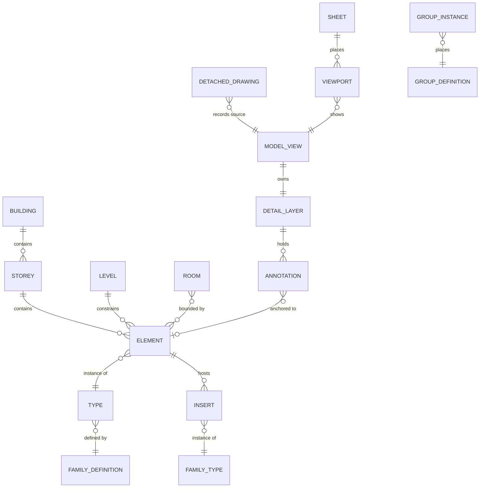

# Domain model

This document defines the object types of an ArchBuilder document, their key properties and
relationships, the invariants every committed revision satisfies, identity rules, and what
recomputes when something changes. It is the schema contract for `archbuilder-model`.

## Storage principles

- Every object is a typed record in an `arc-doc` object table with a stable 128-bit identifier and a
  per-table payload schema version.
- Records store **authored data only**. Geometry, joins, room areas, view drawings, schedule rows
  and quantities are derived and never stored as authority. Caches may be stored in the package for
  speed, keyed by revision, and are discarded when stale.
- Lengths are meters, angles radians, model space is right-handed with Z up. Values are typed
  quantities; display units apply only at the interface.
- References between records are by identifier. A reference to a missing record is invalid except
  where a state field explicitly allows it (orphaned annotations, unresolved links).

## Object catalog

### Project, spatial and datum objects

| Type | Key properties | Relationships |
|---|---|---|
| `Project` | Information fields, settings, units, boundary rule, template flag | One per document; root of spatial tree |
| `CoordinateRecord` | Base point, survey point, true north, CRS, map conversion, precision distance | One per document |
| `Site` | Name, boundary, terrain references | Child of project |
| `Building` | Name, elevation, address | Child of site |
| `Storey` | Name, level reference | Child of building; contains elements |
| `Level` | Name, elevation, elevation base, storey flag | Belongs to a building; referenced by constraints and views |
| `Grid` | Label, curve segments, extents | Belongs to a building or the site |
| `ReferencePlane` | Name, plane, bounds, strength | Belongs to a storey, family or view |
| `DatumExtentVolume` | Name, box | Assigned to datums and views |

### Physical elements

All physical elements share: `id`, `category`, `type_id` (where applicable), `storey_id`,
`created_phase`, `demolished_phase`, `option_id`, `group_member_of`, `work_area`, `parameters`,
`classification`, `ifc_mapping_override`, `pinned`.

| Type | Key properties | Relationships |
|---|---|---|
| `Wall` | Location curve, location line, base and top constraints, profile override, cross-section, flip, function, structural usage, room-bounding, roof binding, band overrides | Type `WallType`; hosts `Insert`, `Opening`; joins via derived `Join` |
| `CurtainWall` | Location curve, constraints, grid rule overrides, manual grid lines, cell map (cell key to panel type) | Type `CurtainWallType`; owns `CurtainGridLine`, `Mullion`, `CurtainPanel` |
| `Floor`, `Ceiling` | Boundary profile, level, offset, slope, shape points, pattern origin | Types `FloorType`, `CeilingType`; host inserts and edges |
| `Roof` | Footprint or extrusion profile, per-edge slope, pitch, overhang, courtyard flags, base level | Type `RoofType`; owns `Dormer` children; hosts edges and inserts |
| `Dormer` | Host roof, placement, dimensions, owned wall IDs, owned opening ID | Reconciles its children |
| `EdgeElement` | Kind, profile, host edge references | Hosted by floor or roof edges |
| `Insert` | Family type, host, host-local position, height, hand, facing | Hosted by a wall, floor, ceiling, roof or face |
| `Opening` | Kind, profile, constraints, hosts (derived for shafts) | Cuts hosts; may be owned by a stair |
| `Component` | Family type, placement, mirror, work plane | Freestanding |
| `Stair`, `Ramp` | Constraints, runs, landings, supports, repeat members | Types; own railings and openings |
| `Railing` | Path, host | Type `RailingType` |
| `ElevatorAssembly` | Cabin type, served levels, part map | Owns walls and doors |
| `TerrainSolid`, `Pad`, `PropertyLine` | Points or TIN, boundaries, setbacks | Site children |
| `StructuralColumn`, `Framing`, `Foundation`, `BeamSystem`, `Truss` | Section, material, axis, end offsets, usage | Analytical counterparts; hosts for reinforcement and connections |
| `Reinforcement` | Shape, set layout, host, cover | Hosted by a concrete element |
| `SteelPart`, `Connection`, `Fastener`, `Weld` | Geometry, profile, grade, parent parts, connection parameters | Steel assemblies; numbering |
| `AnalyticalMember`, `AnalyticalPanel`, `Load`, `BoundaryCondition` | Analytical geometry, releases, load cases | Associated with physical elements |
| `ServiceSegment`, `ServiceFitting`, `ServiceEquipment`, `ServiceSystem`, `ServiceSpace` | Size, route, connectors, system classification, flow | Systems connect through `Connector` records of family instances |
| `Mass`, `MassFloor`, `DividedSurface` | Forms, levels, UV grids | Faces referenced by face-based walls, roofs and curtain systems |

#### The wall of the first slice

The first implemented `Wall` is a reduced record, `archbuilder.wall`, owned by its storey (the wall
stands on the storey's level; the storey must exist). It stores authored data only, lengths in
meters:

| Field | Meaning | Rule |
|---|---|---|
| `name` | Unique within the storey, `Wall <n>` by default | Not blank |
| `start_x`, `start_y`, `end_x`, `end_y` | The baseline's two points, project coordinates | Within 100 km of the origin; the baseline is at least 1 mm long |
| `thickness` | Distance between the two faces: the total of the wall type's layers | 1 mm to 5 m; written only with the type (schema 1.2 makes it a copy of the type) |
| `height` | Height above the base of an unconnected wall; the fallback of a constrained one | 10 mm to 1000 m; 3 m by default |
| `top_level` | The level the top is constrained to; absent for an unconnected wall | Optional reference to a level, cleared when the level is deleted; by default the level of the next higher storey, when there is one |
| `base_offset` | The base's distance above the storey's level | -1000 m to 1000 m; 0 by default |
| `start_join`, `end_join` | How each end joins: `auto`, `butt`, `square` or `disallowed` (schema 1.1; absent in older files, read as `auto`) | `auto` by default; the only authored part of a join |
| `location_line` | Which line of the wall the baseline is: `center`, `exterior` (the exterior finish face), `interior` (the interior finish face), `core_center`, `core_exterior` or `core_interior` (the middle and the faces of the type's core layers; schema 1.2) | `center` by default; changing it keeps the wall's physical position: the stored baseline moves across by the difference of the offsets, and the joins are kept as a move keeps them (neighbors stretch along their own lines to the new corners), so the rooms and floors around the wall stay |
| `wall_type` | The wall type (schema 1.2) | A reference to a wall type of the project; a type in use cannot be deleted; absent only in files from before types until they are upgraded |
| `core_exterior`, `core_interior` | The thickness of the type's layers outside the core on the exterior and the interior side (schema 1.2) | Copies of the type, written only with it; 0 when absent |
| `pinned` | Whether the wall is pinned (schema 1.3) | Absent or false in older files: unpinned; see pin below |
| `top_offset` | The top's distance above its `top_level` (schema 1.4) | -1000 m to 1000 m; absent: 0; no effect on an unconnected wall |
| `top_attach` | The roof or floor the top is attached to (schema 1.4) | Optional reference to a roof or floor, cleared when it is deleted; while set, the top follows that element's underside and `top_level`, `top_offset` and `height` wait unchanged for a detach |

The solid is derived, never stored: a prism over the rectangle of the baseline and the thickness,
from the storey's level elevation plus the base offset, up by the height. With a `top_level` the
height is derived: that level's elevation minus the base, so raising the level raises the wall; a
level that is not above the base is refused. Setting the height of a wall, or giving one when it is
created, leaves it unconnected. The side of a wall is
named from the baseline's direction: the face on the left of the direction from the start point to
the end point is the exterior face, the right one the interior face, so `exterior` puts the body to
the right of the baseline and `interior` to the left. Faces keep their identity through the solid
kernel's face tags (`Side` of the footprint loop: the exterior face is curve 2 and the interior
face is curve 0 of the loop that runs start-right, end-right, end-left, start-left; the two ends
are curves 1 and 3; the caps are `Top` and `Bottom`).

Joins are derived, never stored: when the solids are made, the walls of a storey are read
together and each wall's footprint gets its ends closed against the walls it meets. Only the
per-end style above is authored. Walls whose ends coincide (within 0.1 mm) form a node: two walls
miter, three or four close a star, two collinear walls with equal faces meet flush, and a straight
run through a node lets the others stop at its face. An end on the interior of another wall's
baseline is a T and stops at that wall's near face without entering it. All rules use the faces
(the location line and thickness decide where they are), so walls of different thickness and
location line close without gap or overlap. `butt` and `square` make a corner of two walls run
one wall through (this end stops at the other's face; `square` cuts it square), and the style of
the other end decides which wall runs through; both ends butt cancel into the miter. `disallowed`
takes the end out of every join (square end, overlap allowed). A corner that would reach more
than two thicknesses past the end, or past the middle of the wall, is refused and the ends of
that node stay square; the volume of a wall (the property grid, `inspect` and the IFC `NetVolume`: one rule) is that of its cleaned layers with the openings cut and the slab above it taken into account, so a
closed rectangle counts each corner once. The viewport extracts the walls of a storey again when
any of them is created, changed or deleted. The cleaned layers, the plan lines and the cleaned slabs are kept while
the objects they are made from (the walls of the storey, their types and openings, the slab, the stairs, the levels)
are unchanged, so an edit that touches none of them recomputes nothing.

**Layers at joins.** The footprint above is divided into the layers of the wall's type, and where
walls meet, each layer is cleaned by its function. The functions have a priority, from the highest:
structure, substrate, thermal, finish. At a corner (two walls, or a star) the layers of two
neighbors are matched in order from the faces that look at each other: layers of the same function
connect and turn the corner together, and where the next layers differ the one of the lower priority
stops on the line of the higher one, which goes on. The cores therefore meet core to core and the
finishes wrap the outer side of a corner, whatever the thicknesses. A wall that ends on another
(a T, or the four ends of a cross) runs each layer on until the first layer of the other wall with
the same or a higher priority and stops on its near line, passing over layers of a lower priority;
where layers of different walls still overlap (the through wall's layers under such a layer, or two
walls that cross) the higher priority keeps the area, the lower wall number on equal priority.
The plan draws the lines between the layers that result: a boundary of a layer of one wall with a
layer of another wall is drawn only where their functions or their core status differ, so layers
that connect show no line between them. A butt or square end gets the same cleanup as a T (its layers stop at the near line of the wall it meets). What
the ends of a star of three or more walls leave open in its middle is closed with the core of the strongest wall of the
node, and anything the cleaned layers leave open or push out of the walls' footprints at a node is given back to, or
cut from, the proportional layers, so the layers of a node cover exactly the footprints with no gap and no overlap.
Ends of a disallowed join keep the footprint's end divided in proportion. The cleaned layers are the solids of a wall: its 3D body is the
solid of each layer, in bands of height where doors and windows open it, and the viewport draws
the core, the finish layers and the others in three shades. Nothing of this is stored.

**Wrapping.** A wall type says, for free ends (ends in no join) and for the openings of doors and
windows, which side's finish layers wrap: `none`, `exterior`, `interior` or `both` (see the wall
type below). Every layer outside the core on a wrapped side (membranes have no
thickness) turns into the end or the reveal: each becomes an L whose foot covers the end across the thickness (up to the
middle of the core when both sides wrap), nested outward in, and the core stops short of the end by the total of the
feet, so the length of the wall and the clear opening do not change. The plan lines and the solids show it.

Known limits: walls have no base attachment or curves, and the only inserts are the doors and windows below; a node of three or more walls without a
straight run (a Y) leaves a small notch at its center; two collinear walls of different layer stacks
meet square and show the difference in their lines; at a node of walls of different thickness the
closed star can leave slivers; layer cleanup applies only at ends with the style `auto`; styles other than `auto` apply only at a
corner of two walls and at a T. The viewport extracts a wall again when its storey or the level of its storey changes. A storey
that has walls cannot be deleted; the walls are never deleted with it. `archbuilder.wall.flip` moves a wall's body to the other side of its location line (the
baseline stays; a center line has no side), and `archbuilder.wall.delete`
deletes walls (the named ones, else the selected ones) in one transaction, so one undo restores
them; `archbuilder.object.delete`, the Delete key, deletes the selected walls, else the selected
storey.

#### The door and window of the first slice

The first implemented `Insert` kinds are two reduced records, `archbuilder.door` and
`archbuilder.window`, built-in parametric kinds rather than loadable families. The host wall is the
header owner, so an insert is contained in its wall: deleting the wall deletes its inserts in the
same transaction (the command result and the application name how many), and one undo brings wall and
inserts back. Authored data only, lengths in meters, one layout for both kinds:

| Field | Meaning | Rule |
|---|---|---|
| `name` | Unique among the doors (or windows) of the wall, `Door <n>` or `Window <n>` by default | Not blank |
| `distance` | From the baseline's start to the center of the opening | 0 to 100 km; the opening lies in the clear span (below) |
| `width`, `height` | Size of the opening | 0.1 m to 20 m; copies of the type, written only with it |
| `sill` | Bottom of the opening above the wall's base | 0 to 100 m; the type's default sill when placed or retyped, then the instance's own; the head stays 10 mm below the wall's top |
| `frame_width`, `frame_depth` | Width of the four frame bars, depth across the wall | 10 mm to 0.5 m and 10 mm to 2 m; copies of the type; the solids, the plan symbol and the IFC body use the depth clamped to the host wall's thickness; the frame leaves at least 20 mm clear |
| `operation` | `single_swing`, `double_swing` or `sliding` for a door; `fixed`, `casement` or `sliding` for a window | A copy of the type; the kind decides what is allowed |
| `insert_type` | The door or window type (schema 1.1) | A reference to a type of the kind; absent only in files from before types until they are upgraded |
| `pinned` | Whether the door or window is pinned (schema 1.2) | Absent: unpinned |
| `hand` | `left` or `right`: the hinge side seen from the side the leaf swings toward | `left` by default |
| `facing` | `exterior` or `interior`: the side of the wall the leaf swings toward | `exterior` by default |

Rules: the opening, with 10 mm of clearance, lies in the wall's clear span, the stretch of the
baseline where the joined solid has both faces, so an insert cannot reach into a mitered corner or
a T (a wall that would be created, joined or shortened over an insert is refused with the insert named; an opening may not open into the body of another wall that meets or crosses its wall,
as is a level that moves a wall's top below one); two inserts of a wall keep 10 mm between their
openings at any height; at most 1000 inserts stand in a wall. Moving a wall keeps its inserts at their
distance along it; `archbuilder.wall.flip` reverses the baseline, so it also sets each distance to the
wall's length minus the distance and flips each facing, which keeps every insert where it is and swinging
the same way in the room.

IFC mapping as implemented (`archbuilder-io`, IFC4, lengths in meters, every `GlobalId` from the
object's identifier): a wall maps to `IfcWall`, contained in the `IfcBuildingStorey` of its storey and
placed on the storey with its origin at the baseline's start, base offset up and the x axis along the
baseline. Its body is the extrusion of the joined footprint by the derived height (the corners the
joins give, so the volume is the one of `inspect`); a wall of several layers has instead the cleaned
layers as one faceted B-rep (joins, wrapping, the slabs that meet it and the roof it follows), without the openings, which void it; `GrossVolume` is that body and `NetVolume` the layers with the openings cut. `Qto_WallBaseQuantities` holds `Length` (baseline),
`Width`, `Height`, `GrossVolume` (the joined prism) and `NetVolume` (the volume with the openings
cut, the same rule as the property grid). The wall's own `PredefinedType` stays `NOTDEFINED`; its type
carries one (see element types below), and `Pset_WallCommon` holds `IsExternal` and `LoadBearing`
from the type's function flags. Each door or window maps to an `IfcOpeningElement` (identifier derived from the insert's with
the role `INSERT_OPENING`) that voids the wall and is filled by an `IfcDoor` or `IfcWindow`, both
placed at the center of the opening at the sill. The opening's body is the prism of the width and the
height through the wall's thickness. The insert's body is one faceted B-rep of the frame bars and the
leaf or pane (and a door's handle), the same solids the viewport draws; they are separate closed
solids in one shell. The insert's placement has its y axis toward the side a door swings to, so a
door's `OperationType` follows the hinge: the product reads a door's hand facing the leaf from the side it swings toward, IFC4 reads it looking along the placement's y axis (the swing direction), the opposite viewpoint. A product `left` door has its hinge at +x and is `SINGLE_SWING_RIGHT`; a `right` door has its hinge at -x and is `SINGLE_SWING_LEFT`; a double door is `DOUBLE_DOOR_SINGLE_SWING`, a sliding door `SLIDING_TO_RIGHT` (left hand) or `SLIDING_TO_LEFT`; fixed and casement windows are `SINGLE_PANEL`, sliding windows `DOUBLE_PANEL_VERTICAL`. IFC4 has no operation on the window itself, so the operation,
hand and facing of a casement window are reported as approximated and a fixed window loses nothing.
`OverallWidth` and `OverallHeight` come from `width` and `height`.

Derived, never stored: the wall's solid is the joined solid with each opening cut through its whole
thickness by the foundation's prism subtraction (the volume of the property grid and `inspect` is that
net volume); the insert's own solids are the four bars of the frame, the closed leaf (door, with a
handle opposite the hinge on the facing side) or the glass pane (window), drawn in their own colors.
`archbuilder.door.place` and `archbuilder.window.place` place one insert (a click on a wall, or a
typed distance along the selected wall; the options width, height, sill, hand and facing; chains
continue until Enter or Escape, one undo step each), `archbuilder.insert.flip_hand` and
`archbuilder.insert.flip_facing` flip the selected ones, and `archbuilder.object.delete` deletes the selected
inserts. A double door has two leaves meeting in the middle, a sliding door or window two panels in
two tracks. Known limits: no families, no room relations, arched or non-rectangular openings are
not offered. The plan symbol (the opening across the wall, a door's open leaf with its swing arc, a window's frame and glass line) is drawn as a viewport overlay at a cut 1 m above the wall's base, and an insert is picked from its opening in plan and in 3D ahead of its wall.

#### The floor of the first slice

The first implemented `Floor` is a reduced record, `archbuilder.floor`, owned by its storey (a
storey that has floors cannot be deleted). Its type gives its layers; it has no slope or shape
points yet.

| Field | Meaning | Rule |
|---|---|---|
| `name` | Unique within the storey, `Slab <n>` by default | Not blank |
| `thickness` | The slab's thickness, the total of its type's layers; the slab hangs down from its top | 1 mm to 5 m; a copy of the type, written only with it |
| `top_offset` | The top's distance above the storey's level | -1000 m to 1000 m; 0 by default |
| `vertices` | The boundary: the outer loop, then the holes, each loop in order. Each vertex is a record of the loop number (0 outer), the authored point, and the optional association of the edge that starts there: `wall` (reference, cleared when the wall is deleted), `face` (`interior`, `exterior`, `center`, `core_interior` or `core_exterior`: the faces and the middle of the wall's core; the last two are on the right and on the left of the baseline) and `offset` | At most 1000 vertices and 64 loops |
| `floor_type` | The floor type (schema 1.1) | A reference to a floor type of the project; absent only in files from before types until they are upgraded |
| `pinned` | Whether the floor is pinned (schema 1.2) | Absent: unpinned |
| `arcs` | The arc edges (schema 1.3): records of a vertex number and a bulge, the tangent of a quarter of the edge's included angle (positive for an arc that bends counterclockwise, which is outward for a counterclockwise loop; 0.0 is straight and is not listed) | At most 1000; \|bulge\| at most 10; absent in older files, whose edges are all straight; an arc edge follows no wall |

An edge associated with a wall lies on the line of the chosen face of that wall (the center face is
the center line of the wall type's core), moved by the offset; a vertex that
touches an associated edge is the meeting point of the lines of its two edges, so the floor follows
a wall that moves or changes thickness. The interior and exterior faces are the ones that look into
and away from the enclosed area, whichever way the wall was drawn. A free edge lies on the line
through its two authored points. Deleting a wall (`archbuilder.wall.delete`,
`archbuilder.object.delete`) first freezes the edges that followed it: they keep their last derived
position, lose the association, and the command result and the window report how many (undo restores
both). Rules, checked on every commit that touches the floor or a wall of its storey: each loop is
simple (no crossing, touching or fold-back), no edge is shorter than 1 mm, the outer loop has an
area of at least 1 cm², holes lie inside the outer loop and apart from each other.

`archbuilder.floor.create` takes `points` (with optional `holes`), `walls` (a closed chain in order)
or `picks` (points: each on a wall picks it; a single point inside a closed loop of joined walls,
including walls that end on other walls, picks the smallest loop around it), with `face`,
`type`, `thickness` (a thickness other than the type's gives the floor a one-layer type of that
thickness) and `offset`. `archbuilder.floor.add_hole` cuts a hole from a sketched loop. The
property grid edits the type and `top_offset` through `archbuilder.property.set` and shows the
storey, the area, the volume and the associated walls; `inspect` lists each floor with the same
numbers. Derived, never stored: the boundary, the area (outer loop minus holes, arcs exact), the volume (area
times thickness) and the solid, a prism of the boundary from the top down by the thickness, built
on the exact arcs; the boundary is checked, drawn and written to IFC as chords within 2 mm of the
arcs.

**Cleanup with walls.** Where a floor and a wall *of its own storey* overlap in plan and in height,
the wall's core runs through: the solid of the floor loses the footprint of the core and, when the floor lies on one
side only, of the wall's layers on the other side, so a floor whose edge is on the exterior face is
cut back to the core face it meets. The layers outside the core that the slab still covers stop at
the slab: they end at its underside when the wall reaches up through it and start at its top when the
wall stands on it. A wall of another storey (the walls below a slab) ends under the slab, core and layers
alike, where the slab covers it, and never splits the slab: the slab stays one solid with its openings. A wall
attached to a roof keeps its layers clipped under the roof, in the viewport and in the file. This changes the bodies only (the viewport, the plan and the IFC body agree); the
area, the quantities and the room areas are those of the authored boundary and are unchanged.

**Sketch editing.** `archbuilder.floor.edit_boundary` replaces the vertices (with their arcs and the
walls their edges follow) of a floor in one transaction, validated like every commit (closed loops
that do not cross, openings inside the outline, no edge under 1 mm), pin-aware and one undo step. The
window opens it as a sketch: double click on a floor, the context menu or the Structure menu, or the
typed word `editboundary` (`sinirduzenle`; the shortcut `EB`). The outline and the openings are
loops of vertices and edges: a press on a vertex or on the diamond at the middle of an edge drags it,
`add` puts a vertex on an edge, `arc` makes an edge the three-point arc through a clicked point,
`straight` makes it straight again, `wall` replaces the selected edge by one that follows the wall
clicked, and `delete` removes the selected vertex (a loop keeps at least three). An edge that follows
a wall stays linked until an edit moves or reshapes it; the window says how many edges an edit freed.
Enter or Finish applies everything as one command, Escape or Cancel drops the sketch and leaves the
floor as it was; a sketch that is not valid is refused with the reason and stays open. Offsetting a floor, or splitting a wall that a floor with arc edges follows, is refused with a message that names the
floor (the arcs cannot be kept). Roofs share the association of their edges with walls but have no sketch editing yet.

#### The room of the first slice

`archbuilder.room` is owned by its storey (a storey that has rooms cannot be deleted). A room is
its placement point; everything else is derived from the walls around it. Every wall bounds rooms
unless its type is not room-bounding; there are no separation lines, openings do not split a boundary, and linked documents
do not bound.

| Field | Meaning | Rule |
|---|---|---|
| `name` | `Room` (`Oda`) by default; not unique | Not blank |
| `number` | `101`, `102`, ... per storey by default | A duplicate on one storey is a warning, not refused |
| `x`, `y` | The placement point, authored | Within the coordinate range |
| `department`, `floor_finish`, `wall_finish`, `ceiling_finish`, `base_finish` | Text | Optional |
| `upper_level`, `upper_offset` | The top: the named level, else the level above the storey, else 3 m above the storey's level; plus the offset | The reference is cleared when the level is deleted |
| `base_offset` | The base's distance above the storey's level | -1000 m to 1000 m; 0 by default |
| `pinned` | Whether the room is pinned (schema 1.1) | Absent: unpinned |

The boundary is the smallest closed loop of walls around the point (the floor's loop finding: walls
are split where an end lies on another wall and where two walls cross, so a wall that runs past
another still bounds on both sides, and a stub beyond a crossing is ignored), taken at the interior wall faces; the point must
also lie inside that boundary, not in a wall's thickness. Area, perimeter and volume (area times the
height from base to top) are derived and never stored. States: *enclosed*; *unenclosed* (no closed
loop around the point: warning, no area, perimeter or volume); *redundant* (another room's point is
in the same region: the room with the lowest number keeps the region and its area, each other one
gets a warning and no area until it is removed or moved). A duplicate
number is a third warning. The warnings come from `archbuilder_model::validate::room_findings`, are
shown in the command history after a command that causes them, are listed by `inspect --check`, and
never refuse a change. Moving a wall re-derives every room at once; a room whose point ends in
another region is bounded by that region.

`archbuilder.room.place` takes `points` (each inside a closed loop of walls that has no room yet,
else it is refused), optional `name`, `number` and `department`; `archbuilder.room.place_all` puts a
room at a point inside every enclosed region of the storey that has none. A region with a net area
below `MIN_ROOM_AREA` (0.5 m²) is a sliver between walls: `place_all` skips it and reports the
count (`slivers` in the result, a line in the history), and a click of the Room tool in one is
refused with a message. Walls that lie on top of each other (collinear, sharing a stretch longer
than 1 mm) bound regions as their union, each shared stretch counted once for the longest of them,
so the region around them survives (a wall drawn over part of an outer wall leaves the room whole), and they are a warning
(`ab.model.wall_overlap`) of the commit and of `inspect --check`. Each call is one undo step.
The Room tool chains clicks until Escape or Enter. The property grid edits the text fields, the upper
limit (a choice of the levels above), the offsets and the point, and shows area, perimeter, volume
and state read-only; Delete removes selected rooms; move, copy, rotate and mirror move the point (a
copy takes the next free number). `inspect` lists number, name, storey, state, area, perimeter and
volume.

In a view from above, a room is drawn as a tag at the point (name, number, area in m² with the
language's decimal separator, or the state), a translucent fill of its region (muted for an enclosed room, the warning tone for a redundant one) and, when selected, its
outline at the base and top with the corner edges (the wireframe volume, also in 3D). Rooms have no
mesh: unselected rooms are not drawn as solids in 3D. Only the active storey's rooms are drawn, and in
a view from above only those whose point is in the visible area. A tag is centered on its point and never moved or led away: it is shown only when it lies inside the image and inside its room's region, clear of the notice, the view cube and the level labels, and clear of the tag of a larger room. Every other tag is counted in a notice at the top left ("N room tags not shown, zoom in"), never dropped silently. The level labels stay inside the view and clear of the view cube. Known limits: label sizes are estimated from the text (a high-density display may place a tag a little off); no openings that join
rooms, no sloped tops, no separation lines.

Picking in a view from above uses one ordered list for the hover and the click: doors and windows,
walls, the lines of roofs, roofs by extrusion and floor edges, ceiling edges, stairs, ramps and
railings, shafts and vertical openings, rooms, floors, roofs, ceilings, levels, then grids and
reference planes; a repeated click at the same spot steps down it (within a few pixels and
about 1.5 s of the last click; Escape and moving the pointer start again), and the hover shows what
the click would pick. Other views leave the pick to the viewport, with the door or window first.

#### The stair of the first slice

`archbuilder.stair` is owned by its storey (a storey that has stairs cannot be deleted). Only the
authored inputs are stored; the riser count and height, run lengths, landing, solids, railings and
the shaft opening are derived each time (`archbuilder_model::stair`).

| Field | Meaning | Rule |
|---|---|---|
| `name` | `Stair <n>` (`Merdiven <n>`) per storey by default | Not blank, unique within the storey |
| `shape` | `straight`, `l_turn` (two runs at a right angle with a square landing) or `u_turn` (two runs side by side, 0.1 m apart, in opposite directions, with a landing across both) | |
| `turn` | `left` or `right`, seen walking up; a right stair is the mirror image of a left one | |
| `x`, `y` | The start: the middle of the first riser | Within the coordinate range |
| `direction` | The direction of the first run, an angle | |
| `width` | Of the runs and the landing | 0.5 m to 10 m; 1 m by default |
| `tread` | The tread depth | 0.1 m to 2 m; 0.28 m by default |
| `max_riser` | The highest riser allowed | 0.05 m to 0.5 m; 0.18 m by default |
| `waist` | The waist of the monolithic construction | 0.05 m to 1 m; 0.15 m by default |
| `railing_left`, `railing_right` | A railing on that side | On by default |
| `top_level` | The level it arrives at; else the level above the storey | Cleared when the level is deleted |
| `pinned` | Whether the stair is pinned (schema 1.1) | Absent: unpinned |

Derived: the height (top level minus the storey's level; refused without a level above,
`ab.model.stair_no_top`), the riser count `ceil(height / max_riser)` (at least 2, or 4 for a
turn; at most 200, else `ab.model.stair_risers`), the riser height `height / count` (3.00 m with
0.18 m gives 17 risers of 0.17647 m); an L stair's first run takes the larger half of the risers,
a U stair's the smaller half, so its upper run reaches past the foot and the opening covers the
whole lower run. A run of `n` risers is `(n - 1) x tread` long; its last riser is the edge of the landing or
of the floor above. The stride `2R + T` outside 0.60–0.66 m is a warning (`ab.model.stair_stride`),
never a refusal; two stairs of one storey that overlap in plan are a warning
(`ab.model.stair_overlap`). Stair warnings carry the stair's identifier (detail `object`, field
`object` in `inspect --check`) and appear in the command history when a stair is made or edited. Solids: each run is its stepped side profile with the waist below it (measured
square to the pitch line), extruded across the width; the landing is a slab of the waist (at least
a riser) thick with its top at the landing. Railings on the sides that are on: a top rail 0.9 m
above the line of the nosings (and above the landing) along the runs and the open landing edges,
5 cm in from the edge, and posts at the ends, corners and at most 1.2 m apart. The volume (runs and
landing, railings not counted) is in the property grid and `inspect`.

Shaft opening: every floor of the storey whose level is the stair's top level loses the stair's
footprint plus 5 cm on every side except the arrival edge (a U stair's opening is the rectangle over
both runs and the gap). The opening is derived, never stored; overlapping openings are cut as one. Inside the slab it is
a new hole; across the slab's edge it is subtracted as a notch; an opening that cannot be cut
leaves the slab whole with a warning (`ab.model.stair_opening_uncut`). The floor's area, volume,
solid, picking and IFC body follow; moving or deleting the stair moves or removes the opening.
Stairs do not bound rooms.

`archbuilder.stair.create` takes `start`, `to` (a point the first run heads toward) or
`direction`, `shape`, `turn`, `width`, `tread`, `max_riser`, `waist`, `top_level` and `name`; one
call is one undo step. The Stair tool (Architecture tab Stair, Structure menu, the typed shortcut `ST`, the
words `stair` and `merdiven`, New stair in the context menu with nothing selected) asks for the start
and the direction point with the keywords straight, L turn and U turn (a turn asks for the side),
width and tread (another answer to the turn prompt asks the side again, naming the valid answers); every
prompt shows the riser count and height, a dashed preview follows the pointer, and the next stair
starts with the shape, turn, width and tread of the last one. The property grid edits the shape, turn, width, tread, highest riser, waist, railing sides,
point and the top level (a choice), and shows the storey, direction, risers, riser height, run
lengths, stride and volume read-only. Delete, move, copy, rotate, mirror (a mirror swaps the turn
and the railing sides), dragging, copy, cut and paste (the opening follows the pasted stair) and hide
and isolate work on stairs, all through one list of element kinds (`types::ELEMENTS`); its warnings
appear in the history after any change, an edit of the grid and a paste included; the outliner
lists them under their storey after the floors. In a view from above the active storey's stairs
show the outline, a line per riser, a break line where the plan cut 1.2 m above the base crosses
the stair, the risers above it lighter and dashed, and the walking line with an arrow and the up
text (`UP`, `YUKARI`) just outside the foot. On the storey of the top level the arriving stair shows
the risers above that cut normal and the rest lighter, the break line, the opening's outline and
the walking line from the arrival down to the foot, with the down text (`DN`, `AŞAĞI`) just outside
the arrival. Known limits: no winders, spiral or sketched stairs, no stringers, nosings or
assembled construction, no headroom check, no multistorey repeat.

IFC mapping, planned: an `IfcStair` aggregating an `IfcStairFlight` per run, an `IfcSlab` with
`PredefinedType` `LANDING` for the landing and an `IfcRailing` per side. As implemented: the IFC
writer of the foundation has no stair, flight or railing entity yet, so each stair is named in the
loss report (`ab.io.ifc.stair_not_written`) and nothing is written in its place; its shaft opening is
written as a hole (or notch) of the profile of the slab above, and that slab's net area and volume
have it taken out.

#### Railings and ramps

`archbuilder.railing` is a railing by path (points with a height above the level and the bulge of
the arc to the next point) or hosted on another element, with a type, the extension at each end of
the rail and the railing its top rail continues to. `archbuilder.ramp` is a straight run with a
landing at each end, a width, a thickness and a form. `archbuilder.railing_type` holds the height
of the top rail, the profiles, an optional handrail, the baluster spacing, the post size and how
the rail turns at a corner (miter or fillet); `archbuilder.ramp_type` holds the largest slope and
the thickness. Only these inputs are stored; the walking surface, the posts, the balusters, the
rails and the solids are derived each time.

Types. The type editor lists railing types and ramp types next to the element types: it shows the
type of the selected railing or ramp, edits all its values (checked as typed, one
`archbuilder.railing_type.define` or `archbuilder.ramp_type.define` on Apply, so every railing or
ramp of the type changes in one undo step), duplicates it (`archbuilder.type.duplicate`) and
deletes it, asking for the type its railings or ramps get instead (`archbuilder.type.delete`).
Create similar starts the railing or ramp tool with the type of the selected one; match type
(`archbuilder.type.match`) gives the railings or ramps picked after the source its type, and
leaves objects of another kind alone.

Hosts. A railing is hosted on a stair, a ramp, a floor or a floor edge element (`host`, with
`side`). On a floor it stands on one edge of the boundary (`host_edge`, the number of the vertex
the edge starts at) or, without a number, on the whole outer boundary; on a floor edge element it
stands on one of its chains (`host_edge`, the first chain without it). The rail is on the top of
the slab, 0.05 m in from the edge, so it follows the floor whenever the boundary moves (edges that
follow walls included), and an edge the floor no longer has leaves the railing without a path,
reported as such and never moved to another edge. A railing goes with its host when the host is
deleted. Known limit: copying or pasting a floor does not copy the railings hosted on it.

Rails and joins. The top rail and the handrail are swept along the path in one solid for each
stretch, with a ring of the section at every point in the plane that bisects the two bars meeting
there: a true miter, so the joined bars neither overlap nor leave a gap and the solid has the
volume of the center line times the section. The type's corner setting (miter or fillet) decides
whether the path is rounded before it is swept. A path that turns back on itself by more than 120
degrees is cut square there, and a bar shorter than the miters at its ends is drawn as two bars
that overlap (the only place the overlap remains). A hosted rail has transitions at the joins of
its path: a landing where the slope changes and the heading does not, a turn where the heading
changes (`Derived::transitions`), each with a post and the corner of the type. When a railing
continues to another, its rail is mitered at the first point of the next one's rail and runs to
the middle of the next one's first bar, where the next one's own rail starts; the next one has no
extension at its start, as the first has none at its end.

Ramps of several runs and by sketch. After the first run a ramp can have more runs (`runs`, at
most 16), each with the turn at the middle of the landing before it (to the left when positive, at
most 135 degrees, and the landing must hold the miter of the turn), its length, its landing and,
optionally, its own slope. The slope that carries the rise over all the runs is shared by the runs
that have none of their own; setting the slope of one run (`archbuilder.ramp.set_run`) changes the
elevations of every run after it and none before it, and the top then differs from the level the
ramp was to reach, which is a warning (`ab.model.ramp_top`) along with a run steeper than the
largest slope of the type (`ab.model.ramp_slope`, for any run). `archbuilder.ramp.add_run` adds a
run, `set_run` changes or removes one. The body is a set of convex pieces over the band along the
center line (mitered where it turns), each with the plane its top follows; a slab has the
thickness below the top, a solid a level underside. A ramp by sketch has a `boundary` of straight
edges (a simple polygon) and the run line of its foot, direction and lengths: the slope rises
along the run line over the whole boundary, between the two landings. Its opening in the floor of
the level it arrives at is the boundary up to the arrival edge, and a railing hosted on it stands
on the extremes of the boundary across the run line. In the tool the keyword `sketch` at the first
prompt asks for the run line and then the points of the boundary, ended with Enter. The record
holds `slope`, `runs` and `boundary` only when used (schema 1.1; older files load).

Bounds and drawing. A railing gets at most 4 000 balusters ([`railing::MAX_BALUSTERS`]): one that
would need more has none, keeps its rails and posts and is reported (`ab.model.railing_balusters`),
and `archbuilder.railing.create` says so (`balusters_capped`); the count is computed before any
baluster is. In a plan view ramps and railings are drawn under their own categories (`ramp`,
`railing`, flags `show_ramps` and `show_railings`), not under stairs, and each run of a ramp has
its slope in percent written at its middle (with the decimal separator of the language, marked when
it passes the type's largest slope). While the railing or ramp tool asks for points, a dashed
preview follows the pointer: the path so far for a railing, the outline and walking line of the
ramp from its foot, the run line and the boundary so far for a ramp by sketch. Typing `railing`
(`korkuluk`) or `ramp` (`rampa`) at the command line starts the tool, and Repeat repeats it.

#### The roof of the first slice

`archbuilder.roof` (schema 1.0) is a roof by footprint, owned by its storey. Only the authored
inputs are stored; the outline, the surface, the ridges, hips and valleys and the slab are derived
each time (`archbuilder_model::roof`).

| Field | Meaning | Rule |
|---|---|---|
| `name` | `Roof <n>` (`Çatı <n>`) per storey by default | Not blank, unique within the storey |
| `thickness` | The slab's thickness: the total of its type's layers | A copy of the type, written only with it |
| `base_offset` | The underside along the footprint line (the wall line) above the storey's level | -1000 m to 1000 m; by default the top of the highest picked wall, else 0 |
| `edges` | The footprint, one loop in order, straight edges only. Each edge record: the authored start point `x`, `y`; the optional association `wall`, `face` and `offset` of a floor edge; `sloped` (whether the edge defines a slope); `slope` (an angle, kept while the edge is a gable); `overhang` (absent: the roof's) | 3 to 256 edges; slope 1° to 85°; overhang 0 to 10 m |
| `overhang` | The overhang of the edges without their own | 0 to 10 m; 0.5 m by default |
| `roof_type` | The roof type | Absent only in a file edited by hand |
| `pinned` | Whether the roof is pinned | Absent: unpinned |

Derived: the footprint, from the authored points and the wall faces the associated edges follow,
exactly as a floor's boundary (so moving or rethickening a picked wall moves the roof; deleting it
freezes the edge where it was); the outline, every footprint edge moved outward by its overhang;
the underside, in which each sloped edge's plane passes through its footprint edge at the base
height and rises inward at the edge's slope, an overhang dropping below the base by the overhang
times the slope, and a gable edge's plane is vertical through its outline edge. It is solved as
the weighted straight skeleton (`arc_geom::weighted_skeleton`) of the footprint with each sloped
edge moved out to where its plane is as low as the lowest eave, and clipped to the outline. The
slab lies between the underside and the top, whose planes are the underside's moved square to the
slope by the type's thickness (so the layers are across the slope) and solved the same way. The
lines of the skeleton inside the outline are the ridges (level), the hips (from convex corners)
and the valleys (from inward corners). The surface of a roof is derived once per document
revision and shared by the viewport, the plan, picking and the walls under it.

Rules, checked on every commit that touches the roof or a wall one of its edges follows: the
footprint is a simple loop of edges of at least 1 mm (`ab.model.roof_footprint`); the outline does
not cross or touch itself (`ab.model.roof_outline`); at least one edge slopes
(`ab.model.roof_no_slope`); neighboring collinear edges have one slope
(`ab.model.roof_collinear_slopes`); every part of the outline is reached by a sloped edge and no
gable edge meets an inward corner, whose vertical plane would run into the roof
(`ab.model.roof_unclosed`); the surface could be computed and its cells cover the outline
(`ab.model.roof_degenerate`). The last three name the point near the problem. A roof is never given
invented vertical faces or a surface that does not cover its outline.

`archbuilder.roof.create` takes `points`, `walls` or `picks` (as a floor; picked walls give edges
on their exterior faces), `face`, `edge_offset`, `slope` (15° by default), `gables` (the numbers of
the edges without slope), `overhang`, `base_offset`, `type` and `name`. `archbuilder.roof.set_edge`
sets `sloped`, `slope` and `overhang` (or the roof's again with `roof_overhang`) of the given edges
(all when none are given); a new slope reaches the sloped edges and is kept by the gables.
`archbuilder.roof.move_vertex` moves a footprint point (the two edges at it stop following walls,
fixed where they were); `archbuilder.roof.move_edge` moves an edge outward or inward (an edge that
follows a wall keeps following it at a new offset). Delete, move, copy, rotate, mirror, copy and
paste, hide and isolate take roofs through the shared kind list; the outliner lists them after the
stairs. Roof types are as floor types (layers from the top down); a new project starts with a
generic 300 mm roof type and timber rafters with insulation under tiles, and a document without
roof types gets the same two when its first roof is made.

The `.archb` addition is backward compatible: the record types `archbuilder.roof` and
`archbuilder.roof_type`, the wall's optional `top_offset` and `top_attach` (schema 1.4) and the
project's optional `slope_unit` (schema 1.1) are new, so files from before roofs load unchanged.

In the application the Roof tool (Architecture tab, Structure menu, `RF`, the words `roof`, `çatı`, `cati`,
New roof in the context menu) is the floor tool's picks and sketch with the keywords `slope` (`s`;
`k` switches to the sketch), `overhang` and `base`; a prompt's own shortcut letter wins over the
English letters of other keywords. The slope is typed as in the grid below and refused outside 1°
to 85° with the range named. The property grid edits the type, base offset, overhang and one slope for
every sloped edge (a note when they differ), then per edge whether it defines a slope, its slope (typed in the project's
slope unit, `slope_unit` of the project: degrees, percent or rise to run, degrees for a file from
before it; an angle with `°`, a percentage with `%` or a rise over a run such as `1:2` is read
whatever the unit, and a value outside the range is refused naming it) and its overhang; it shows the
storey, the plan area, the top elevation, the attached walls and the walls the edges follow. A
selected roof has a square handle at each footprint point and a diamond at the middle of each
edge. In a view from above the slabs of the roofs of the active storey are left out of the viewport, so
the walls the plan cuts stay in view and are picked first; the roofs show a faint tint, the
outline with the overhangs, the ridges and hips as lighter lines and the valleys dashed, and on
each sloped edge an arrow down the slope with the slope as text, moved along the edge where it
would cover a room tag or another text (none where nothing is free). The drawing follows the
camera of each frame.

Wall tops: `archbuilder.wall.attach_top` attaches the tops of the given or selected walls to a
`target` roof or floor, else to the roof over each wall's middle with the lowest underside above
its base, else to the floor of the next storey up (in the application Attach top asks for walls
when none are selected, then for a click on the roof or floor; Enter takes the one above, and the
history says how many walls follow and how many cannot); `archbuilder.wall.detach_top` detaches them,
and each wall has the top it had before (its level, offset or height were kept). A wall attached
to a roof is made from its joined footprint cut by the cells of the roof's underside: each piece
rises to its cell's plane, so a wall at a gable end gets its triangle, a wall under hips or valleys
its sloping top and an eaves wall a top sloping across its thickness; a part of the wall outside
the roof's outline keeps its own top, with a vertical step where they meet. A wall attached to a
floor stops level at the floor's underside. Nothing derived is stored, so a roof edit (slope, footprint,
type, base offset) moves the tops in the same transaction; a wall that cannot follow (no part under
the roof, an underside down to its base) keeps its own top with the warning
`ab.model.wall_attach_failed`. Deleting a roof or floor detaches its walls in the same step and says
how many. Typed shortcuts `AT` and `DT`; the context menu of a selection with walls has Attach top and
Detach top. Known limits: no base attachment, no courtyards or holes, no roof joins or cuts with other
roofs, no rafter cuts, fascias or dormers, and a wall top clipped to a roof keeps the openings of its
doors and windows only where they stay below the underside.

IFC mapping: a roof is an `IfcRoof` contained in its storey, with its slab as an `IfcFacetedBrep`
in the storey's coordinates, `PredefinedType` `HIP_ROOF` when every edge slopes, `GABLE_ROOF` for
four edges of which two are gables, `SHED_ROOF` for one sloped edge, else `FREEFORM`,
`Qto_RoofBaseQuantities` (`GrossArea`, the sloped area; `ProjectedArea`) and `Pset_RoofCommon`
(`IsExternal`). Its type is an `IfcRoofType` with the type's `IfcMaterialLayerSet`. A wall attached
to a roof writes its clipped solid as an `IfcFacetedBrep` (its openings stay `IfcOpeningElement`s),
with the gross volume and height of that solid.

IFC mapping: an enclosed room is an `IfcSpace` aggregated by its `IfcBuildingStorey` with
`IfcRelAggregates` (not contained), `PredefinedType` `INTERNAL`, with a body of an extruded area
solid of its boundary, with the courtyards as voids, from the base up by the height, or, when its top is not level
or lower than its upper limit, the room's solid: an extrusion up to the level top, else a faceted B-rep. `Name` is the room number and `LongName` the
room name (a room without a number takes its name as `Name` and has no `LongName`).
`Qto_SpaceBaseQuantities` holds `NetFloorArea` (at the wall faces), `GrossFloorArea` (to the wall
center lines), `NetPerimeter` (the outer loop plus every courtyard loop), `Height` (the mean height of the solid) and
`NetVolume` (the volume of the solid), and `Pset_SpaceCommon` holds `Reference` (the number). An unenclosed room has no
region and a redundant room shares its region with another room; neither is written, and the loss
report names each one (`ab.io.ifc.room_unenclosed`, `ab.io.ifc.room_redundant`).

IFC mapping of ceilings and openings: a ceiling is an `IfcCovering` with `PredefinedType` `CEILING`, contained in
its storey, with an extruded area solid of its boundary (holes included) from its underside up by the thickness, or an
`IfcFacetedBrep` when it slopes, `Qto_CoveringBaseQuantities` (`Width`, `GrossArea`, `NetArea`) and
`Pset_CoveringCommon` (`IsExternal`); its type is an `IfcCoveringType` with the type's `IfcMaterialLayerSet`. A wall
opening is an `IfcOpeningElement` with `IfcRelVoidsElement` on its wall, its profile in the wall's plane
(an arch as chords) extruded across the wall. A shaft is one `IfcOpeningElement` for each floor, roof and ceiling it
cuts, each voiding that host; a vertical opening is one on its host. The bodies of the hosts are written with the cuts
taken out as well (a roof cut that cannot be made is reported as `ab.io.ifc.cut_not_applied`). Arc edges and
arches are written as chords (`ab.io.ifc.arc_faceted`).

Backward-compatible `.archb` additions: the record kinds `archbuilder.ceiling`, `archbuilder.ceiling_type`,
`archbuilder.wall_opening`, `archbuilder.shaft` and `archbuilder.vertical_opening`, each at schema 1.0. A file from before
them has none and loads as it was; a document gets the two default ceiling types when it makes its first ceiling.

#### The ceiling, the openings and the room solid of the first slice

`archbuilder.ceiling` (schema 1.0) is a ceiling owned by its storey. Its first seven fields have the
positions and meaning of a floor's (`name`, `thickness`, the underside's height, `vertices`,
`ceiling_type`, `pinned`, `arcs`), so a ceiling's boundary is read, associated with wall faces and
edited with the floor's sketch (`archbuilder.floor.edit_boundary` takes a ceiling too). The
boundary, the underside, the grid lines and the body are derived and kept per ceiling while the
objects they read are the same objects ([`archbuilder_model::ceiling::derived`]): the ceiling, its
walls, type, storey and level, its vertical openings and the shafts. A room renamed, a floor edited
or a ceiling of another storey recomputes nothing.

| Field | Meaning | Rule |
|---|---|---|
| `name` | `Ceiling <n>` (`Tavan <n>`) per storey by default | Not blank, unique within the storey |
| `thickness` | The body above the underside: the total of its type's layers | A copy of the type, written only with it |
| `height_offset` | The underside's height above the storey's level, at the slope arrow's start line when there is one | -1000 m to 1000 m; the type's, 2.6 m by default |
| `vertices`, `arcs` | The boundary as in a floor: loops of vertices with an optional wall face association, arc edges as bulges | As a floor's; a click inside a room takes the room's region, the loop of walls that bound rooms at their interior faces |
| `ceiling_type` | The ceiling type | Absent only in a file edited by hand |
| `grid_x`, `grid_y`, `grid_rotation` | The origin and the rotation of the type's grid pattern, absolute: they stay when the boundary changes | 0 by default |
| `slope_x`, `slope_y`, `slope_direction`, `slope_length` | A slope arrow: a point of the start line, the direction the underside rises in and the arrow's length | Absent point: a flat ceiling |
| `slope`, `end_height` | The arrow's rise: an angle (at most 85°), or the underside's height above the level at the arrow's end | `slope` wins when both are set |
| `pinned` | Whether the ceiling is pinned | Absent: unpinned |

`archbuilder.ceiling_type` has the layers and core of a floor type and, after them, `height_offset`
(the height a new ceiling gets, 2.6 m), `grid_x` and `grid_y` (the tile size, 0 for a plain
ceiling) and `grid_angle`. A new project has two: a generic 20 mm board and a suspended grid of 600
by 600 mm tiles (named in the interface language). In plan the ceiling is above the cut: its outline
is dashed, its grid lines are clipped to its boundary (a ceiling that would need more than 2000 lines
of one direction draws none), and a slope arrow shows its start line, direction and slope; nothing is
filled and the plan picks a ceiling only where nothing else is.

A ceiling stays between its storey's level and what is over its own footprint: the slab or roof
above, else the level above. A command that makes or changes a ceiling so that it leaves that range
(create, paste, copy, move and the other modify tools, a drag, a property) is refused with a message
that names the ceiling and the element. A change of what is above (a slab, a roof, the walls they
follow, a level, a storey) that leaves a ceiling out of its range is carried out: the command line
says so once and the warnings panel lists it until it is fixed. Such a finding never refuses an
unrelated edit.

`archbuilder.wall_opening` (schema 1.0) is a bare opening hosted by a wall (the header owner), placed like a
door by its distance along the baseline. `distance`, `width`, `height` (the arch's rise
included), `sill` have the meaning of a door's; `rise` is the sagitta of a circular arch on top (0:
a rectangle), `pinned`. It is an insert of the wall (`archbuilder_model::insert::Kind::Opening`):
the wall's body, its plan lines and its quantities are cut by it, it moves, mirrors and copies with the wall
and is refused where a door would be.

`archbuilder.shaft` (schema 1.0) is a footprint (`vertices`, `arcs`) with a base and a top: `base_level`
(absent: the level of its storey) and `base_offset`, `top_level` (absent: the level above its
storey) and `top_offset`, and `pinned`. It cuts every floor, roof and ceiling whose body its span
overlaps by more than a tolerance (touching a face cuts nothing), now and when the element is added
later. `archbuilder.vertical_opening` is a footprint cut in one floor, roof or ceiling, which hosts it
(the header owner); it goes where its host goes when the host is moved or copied. A floor's area and
volume, a ceiling's, and a roof's body have the openings taken out; a cut that crosses a ridge, hip or
valley of a roof is not cut in its body (the opening is still written as a void, and the loss report
says so). The plan marks a shaft with its outline and a cross on every storey whose level is within
its span.

In the application the tools are in the Architecture tab, the Selection tab and the Structure menu and have the typed shortcuts
`CL` (ceiling: a click inside a room makes it, `sketch` sketches it), `OP` (wall opening, placed like a door; the
keyword `rise` makes it an arch), `SH` (shaft, a sketch) and `VO` (vertical opening in the selected floor, roof
or ceiling, a sketch); `SO` sets a ceiling's slope arrow (`archbuilder.ceiling.set_slope` with `from`, `to` and
`slope` or `end_height`). The property grid types a ceiling's slope (a new arrow runs along x across its boundary), grid
origin and rotation, a shaft's base and top levels and offsets, and shows a room's height and volume. A double click on a
ceiling opens its boundary sketch.

A room's solid (`archbuilder_model::room::shape`) is its footprint under a top that follows, piece by
piece, the lowest of the ceilings of its storey, the roofs and the floors of the storeys above that
lie above the room's base (openings taken out), else its upper limit; a surface above the limit does not bound the room.
Surfaces are ordered by their lowest elevation over the room: the lowest governs where it covers, the
next governs the rest. The volume is exact for planar pieces; the height is the mean height, the
unbounded height is the limit's. The area is the footprint's and unchanged. The IFC space has this
body (an extrusion when the top is level). The result is kept per room while the room, the walls
of its storey with their types, the ceilings of the storey, the roofs, the floors above, the levels,
the storeys, the stairs and the openings are the same objects.

#### The plan view of the first slice

`archbuilder.plan_view` (schema 1.1) is the plan view of a storey, owned by it (deleting the storey
deletes its views). Its record holds authored settings only: the cut height above the storey's level
(1.2 m by default), an optional top above the level (else the next level, else 3 m), whether the
overhead range between the cut and the top is drawn, the scale denominator (100), the detail level
(`coarse`, `medium`, `fine`), whether the storey below shows faint underneath, one flag per category
(walls, floors, roofs, ceilings, doors, windows, stairs, rooms, openings and shafts, and, in schema
1.1, railings and ramps, which a file from before it shows; ceilings are off in a new view, since
they belong to ceiling plans), the elements hidden in this view (one optional
reference each; deleting an element drops its entry), the bottom of the range relative to the level
(0 by default) and the view depth below it (1 cm under the level by default, so a slab whose top is
the level is beyond the cut). Everything below the cut down to the view depth draws beyond the cut.
Names are unique within a storey; the view depth must not lie above the bottom, the bottom must lie
below the cut and the cut below the top.

Every storey has one default view named after it, made with the storey (`archbuilder.project.new`,
`archbuilder.storey.add`). `archbuilder.view.duplicate` copies a view under a new name,
`archbuilder.view.rename` renames it, `archbuilder.view.delete` deletes it (the last view of a storey
stays), `archbuilder.view.hide_elements` and `archbuilder.view.show_elements` change the elements
hidden in it, and the property grid edits the other settings through `archbuilder.property.set`; each
is one undo step. A document saved before views existed has none and opens unmodified: the outliner
lists its storeys among the views, and opening one shows the storey's default view (the settings of a
new view), which exists only while it is shown and is never written, so opening it is no edit and no
undo step. The property grid shows its settings with a note that it is the storey's default view.
The first change of a setting (`archbuilder.view.set`), a rename, a duplicate (which keeps the default
as a view beside its copy) or a hide in view makes the view and applies the change in one undo step;
undoing it shows the default view again and, back at the saved state, the document is unmodified.
It cannot be deleted. The record type is a backward-compatible addition to the `.archb`
format: an older application reading a newer file sees the views as records it does not know.

#### Selection sets and model statistics

`archbuilder.selection_set` (schema 1.0) is a named, saved list of elements, owned by the project.
The record holds a name (unique among the sets, case folded) and its members as one optional
reference each; element identifiers never change, so a set stays valid across edits, and deleting an
element removes it from every set (the delete is one undo step that also restores the entry). Only
building elements are members (not levels, storeys or types). `archbuilder.set.create` (the given
elements, else the selected ones), `archbuilder.set.update` (add and remove members),
`archbuilder.set.rename` and `archbuilder.set.delete` are each one undo step;
`archbuilder.set.select` makes the members the selection (or adds them) and changes no document.
Rule-based sets (category and parameter conditions) and a report of the members dropped by a delete
are not built yet. In the window, the Save set button asks for a name and saves the selection; the
Select set button asks for the name of a set (the first by default) and selects its members.

`archbuilder.model.statistics` returns a report derived from the document and never stored: element
counts by kind, by type (instances without a type under an empty name) and by storey, and the number
of plan views, selection sets and element types. `archbuilder-cli inspect` prints it as `statistics`
beside the `selection_sets` list; the window's Statistics button says it in one line above the
command line. Stored size by table, the largest families and measured
regeneration time are not part of it yet.

The drawing is derived ([`archbuilder_model::plan`]) and never stored: an implementation of the
`arc-view` source interface for one view. A wall gives one part per layer of its cleaned solids, with
the layer's material as the join key, so the layers of one material join across walls and a seam shows
only where materials differ (coarse detail joins all layers of all walls); a floor gives a part per
layer of its type; roofs, ceilings, stairs, doors and windows (at fine detail) give bodies. Symbols,
which are curves, come with their objects: the door swing and leaf line, the glass lines of a window,
the walking line, arrow and break line of a stair, the outlines and crosses of shafts and openings, and
the outline of a room. Text (room tags, stair texts) and the room fill stay with the application,
which draws them over the drawing. What lies below the cut draws beyond (thin), what is cut draws
thick, what lies above up to the top draws dashed, and nothing is drawn as hidden. An element the cut
crosses draws none of its own parts above the cut (the wall over a door head, the head of a door
frame are not repeated as overhead lines). Besides its storey's elements a view draws the walls (with
their doors and windows) and roofs of the storeys below that rise past its level, classified against
its range like its own; a stair arriving from the storey below draws its treads as lines beyond the
cut with its walking line and arrow. Line weights scale with the view scale. The drawing is built in
two passes, the geometry and the rooms, each kept while the objects it reads are the same objects:
the geometry reads the walls, doors, windows, wall openings, floors, roofs, ceilings, stairs, shafts,
vertical openings, every element type, the levels and storeys; the rooms read the rooms, the walls
and the wall types (which walls bound rooms). Renaming a room builds only the rooms again. A build that
fails gives an empty pass whose diagnostic the warnings panel lists while the view is open. A
drawing's primitives link back to their objects; a click in a plan view picks among the objects whose
drawing lies under the pointer, in the order of the picking list, and a selected element is outlined
by its own lines and fills, not by a fill it shares with other elements.

The application draws only the views a tab shows: a view builds when it opens and after a commit that
changes what it reads, on the shell's extraction workers, never on the interface thread. The rooms of
every storey and their solids are derived there too after a commit; the room tags and the property
grid's derived values (room areas and volumes, wall volumes) show what is derived already and wait
for the rest rather than derive it on the interface thread. In a plan view a click, a hover and a
drag take what the view's drawing has under the pointer, never an element of another storey above
it. When an undo removes the view being shown, the 3D view and its camera come back. Opening a
plan view sets a camera looking straight down, framed on the storey's elements, with rotation locked;
going back to the 3D view restores the 3D camera. Temporary hide, isolate and hide by kind work in a
plan view as in the 3D view: they are the tab's state, never saved or undone, and filter the drawing
through object overrides of its definition. Hide in view is the view's own list, a document edit;
Unhide all ends only the temporary state, and Show hidden in view empties the view's list.

## Selection and modify commands

Selection is the tab's transient state, never an undo step. A click selects, Shift adds, Ctrl toggles
(removes an object already selected); a window dragged left to right takes the objects that lie
fully inside, a crossing dragged right to left those it touches, with the same modifiers; Escape
clears. A band that takes a wall also takes the doors and windows in it. The property grid shows the
fields the selected objects share and "(mixed)" where their values differ; one edit applies to all
of them as one undo step.

### Editing tools

`archbuilder-commands/src/edit.rs` adds editing commands to move, copy, rotate and mirror. Each is
one transaction and one undo step, starts from the Modify menu, the Modify tab, the context menu where
it applies, or a typed name, and runs in the modify tool (pick first or pick later, Enter and
Escape as for move). Commands that pick take points: a point picks the nearest wall face, wall
center line or floor edge, or the wall whose body is nearest, within about ten pixels.

- **Align** (`archbuilder.modify.align`, `AL`): pick a reference line, then lines of other walls or
  floors; each element turns about the picked point by the smallest angle that makes its line
  parallel, then moves across onto the reference. The reference stays for the next pick until
  Escape. Walls keep their joins and their doors and windows follow, as a move does. There are no
  grid lines yet.
- **Offset** (`archbuilder.modify.offset`, `OF`): the selected walls and floors are copied (the
  default) or, with the Move option, moved across by a typed distance or by the distance of a picked point, toward
  the side of the point. Selected walls joined end to end offset as a chain whose corners meet
  again; a floor's boundary grows when the point is outside it and shrinks inside (its edges become
  free edges). A dashed outline shows the result while the side is chosen; the tool repeats until
  Escape, keeping the Copy or Move choice and offering the last distance (Enter takes it); after
  a copy the next offset starts from the copies.
- **Trim and extend**: to corner (`archbuilder.modify.trim`, `TR`: two walls meet at the corner of
  their baselines; repeats until Escape), to a boundary one wall at a time (`trim_to`, `TB`, the boundary stays until
  Escape) or several at once (`trim_many`, `TM`, Enter ends the picks). The picked part of each
  wall stays. Doors and windows keep their place in plan; one the wall no longer reaches refuses
  the command, naming it. Rooms follow, being derived.
- **Split** (`archbuilder.wall.split`, `SL`): at a picked point (snaps apply) or at a typed distance
  from the end nearest a second pick, with an optional gap. The wall keeps its identifier as the
  first piece; the second is a new wall with the same values. Doors and windows go to the piece
  that holds them and keep their identifiers; one across the cut (with the side clearance the fit
  rule asks for) refuses the split. A floor edge that followed the wall follows the piece it lies
  along; one across the cut gets a vertex there (two with a gap, the edge across the gap following
  no wall), so the floor keeps its outline and no edge runs past its wall. A merge joins such
  edges again. The outer ends keep their join styles. **Merge** (`archbuilder.wall.merge`, `MG`): two walls that are collinear,
  touch end to end and have the same type, thickness, height, base, top and location line become
  the first; the second's doors and windows (and floor edges that followed it) move to it.
- **Arrays** (`archbuilder.modify.array`, `AR`; `array_radial`, `RA`): independent copies of the
  selection, no group. Linear: a count, a base point and the second item, or with Last the last
  item. Radial: a count, a center and the angle covered (a full turn spaces the items evenly). A
  door or window alone arrays along its wall: the step is projected onto the wall, and a step
  across the wall is refused with a message.

### Pin

`archbuilder.element.pin` (`PN`) and `unpin` (`UP`) set the optional `pinned` field that every
element kind carries (schema versions above; older files load unpinned and need no upgrade). A command that would move, reshape or delete a
pinned element is refused with `ab.model.pinned`, which names it and points to Unpin: the rule is
checked on every transaction against the state before it (`validate::pin_refusal`), so it covers
the modify and editing commands, Delete, dragging and handles, and property edits. A pinned element
may still be renamed, selected, copied and retyped by editing its type; a room keeps its number and
finishes editable. A pinned element shows a small pin mark in plan; the property grid shows the flag,
and the context menu offers Pin or Unpin.

### Warnings register

`validate::register` lists the model's warnings over the whole document with the rules the commands
already apply: stairs (no layout, stride, overlap, uncut opening), rooms (not enclosed, redundant,
duplicate number), walls on top of each other and open corners, floor edges whose wall no longer
bounds them, doors and windows that open into another wall, and instances whose copies of their
type's values differ. Each entry has a kind, a severity and the elements involved. It is derived:
the Warnings panel recomputes it whenever the document changes, so a fixed problem disappears; the
panel filters by kind, shows the count in its heading (the shown and the total count while
filtered), and a double click selects the elements and frames them. A warning never refuses an
unrelated command: a command is refused for a door or window that opens into a wall only when it
placed or changed that door or window, or drew that wall. Reshaping an existing wall (a modify
command, a handle, a property) warns instead: the history names the door, and it stays listed here. A refused pick of the modify tools is said in the command line right after
the picked point.

### Direct manipulation

With no tool running, the pointer edits the selection directly (`apps/archbuilder/src/direct.rs`);
each gesture ends in one command and so one undo step, and Escape during a gesture changes nothing.
A press on a door or window, a wall or a selected floor claims the gesture; a press elsewhere (or with
Shift) still starts the selection band. A drag shorter than 4 pixels is a click.

- **Move.** Dragging a selected object moves the whole selection; dragging an unselected one selects
  it first. Snapping and tracking are those of the move tool (end points, wall bodies, directions
  from the press point, a 10 mm grid); the dragged walls' own ends do not attract. A preview shows
  the walls as they would stand, neighbors that keep their join included. Releasing with Ctrl held
  copies (`archbuilder.modify.copy`) instead of moving (`archbuilder.modify.move`). A door or window
  dragged alone slides along its wall, in whole centimeters, and stops at the clear span and the
  neighboring openings instead of being refused.
- **Handles** of a single selected wall: both baseline ends (`archbuilder.wall.move_end`) and, in
  views not from above, the top (`archbuilder.property.set` of `height`, which disconnects the top
  from its level; steps of 50 mm; the wall shows as a ghost box at the new height with its height
  as a label). The end keeps the other end and the openings' distance from it, and keeps the
  joins: a neighbor whose end met this end with an auto, butt or square join takes the same corner
  point, and a stem whose end stands on the wall stretches or shrinks along its own line to the
  wall's new line; a free end, or a disallowed join on either side, moves alone. The neighbors'
  openings keep their place, and the move is refused, naming the opening and the range of the wall
  as it would stand, when an opening no longer fits. The label while dragging shows the length and
  the angle measured from the end that stays. A selection with walls or floors has a rotation
  handle about the center of its bounds, in steps of 15 degrees (free with Shift)
  (`archbuilder.modify.rotate`). A selected door or window has two flip handles that flip its hand
  and its facing on a click.
- **Handles** of a single selected ramp: a square at the foot (`archbuilder.ramp.move_end`, the
  end of the first run stays, so the run turns and changes length), a square at the end of the
  first sloped run (the foot and the landing in front of the slope stay) and a diamond at the
  middle of the left edge of that run, in steps of 50 mm (`archbuilder.property.set` of `width`; a
  ramp by sketch has none). A single selected railing by path has a square at each point of its
  path (`archbuilder.railing.move_point`, the height stays; a point dropped on its neighbor makes
  nothing); a railing on a stair, ramp or floor follows its host and has none. A selected ramp or
  railing by path is dragged and turned like a stair.
- **Alt** held during a drag turns snapping off (the pointer's own point, whole millimeters of
  height, free rotation). Escape ends a drag and leaves the keyboard focus in the viewport.
- **Temporary dimensions.** A single selected wall shows the distance between its center line and
  the center lines of the nearest parallel walls on either side. A single selected door or window
  shows the gaps between its edges and the ends of the wall's clear span. A wall's value is written
  a quarter of the way from the other wall, clear of a room's tag. A click on a value opens an input
  with the value selected (in the project's unit, or with a unit typed; Escape closes it; an entry that is not a
  length is reported and the input stays open); Enter moves the object
  (`archbuilder.modify.move`) so that the dimension has the typed value.
- While a wall is drawn, a label at the cursor shows the live length and angle.
- Handles and dimensions are overlays, hit-tested within 7 pixels and highlighted on hover; over a
  handle the mouse pointer changes.

### Everyday habits of the viewport

These are interface behavior in `apps/archbuilder` (`interaction/habits.rs`, `menu.rs`, `shortcuts.rs`,
`selection.rs`, `visibility.rs`); everything that changes the document is still a command and one undo step.

- **Tab** with the pointer over a view from above and no command running steps the hover to the next
  candidate under the pointer (the list of the picker: doors and windows, walls, rooms, floors, levels)
  and back to the first after the last; a click then selects the candidate the hover shows. A move of
  more than 4 pixels starts again at the top. A second click within 0.4 s of a click picks the same
  object (it is the second click of a double click); a repeated click after that still steps down.
- **Secondary click** opens a context menu; nothing happens silently on the secondary button any more.
  While a command runs the entries are Enter (the old secondary-click action, now the first entry),
  Cancel and, when an answer can be taken back, Undo last point. Idle with nothing selected: Repeat last
  command, Paste (when the clipboard holds something), Select all, Zoom extents, Unhide all. With a
  selection: Delete, Move, Copy, Rotate, Mirror; Copy to clipboard; Hide, Isolate, Hide this kind,
  Isolate this kind, Unhide all; Select all of this kind and, when the selection holds several kinds,
  one Keep only entry per kind (the selection filter); Properties. A secondary click on an unselected
  object selects it first.
- **Double click** (primary, view from above, no command running): on a wall it selects the walls joined
  to it end to end; on a floor it starts the add-hole flow for that floor (there is no sketch edit mode
  yet); on a room it opens an inline rename of the room (Enter renames, Escape cancels).
- **Clipboard.** Ctrl+C copies the selected elements of every kind `archbuilder.modify.copy`
  copies (walls with their doors and windows, curtain walls with their grid edits, panel overrides
  and type, floors with their edges and openings, rooms, stairs and ramps with their hosted
  railings, railings by path, roofs, roofs by extrusion, ceilings, shafts, grids and reference
  planes) as content, a snapshot of their field values (`archbuilder.clipboard` content, JSON),
  with the lower left corner of their plan extent as the base point, and puts a short text on
  the system clipboard (the platform reports the paste shortcut only while that clipboard holds
  something). A wall's level-constrained top is stored as its effective height. Ctrl+X copies and
  deletes in one undo step. Ctrl+V asks for an insertion point with the base at the pointer and a
  ghost of the copy; Enter or Space pastes in place (`archbuilder.clipboard.paste` with `content`,
  a copy translated by the displacement from the base to the point) into the storey the selection is
  in, else the lowest. `archbuilder.clipboard.paste_to_storey` pastes into the selected storey at
  the same plan position. Grids and reference planes go to the building of that storey, a grid with
  the label after its original's; a type, level or host the document does not have is dropped (the
  default type, the storey's own levels). The clipboard is one for the whole application and its
  content does not depend on the originals, so a paste works after they are deleted and in another
  open document (another tab). Each paste is one undo step and the joins re-derive. A
  paste in place over identical walls says once that the pasted objects lie on top of their
  originals instead of listing each collision. Copying with nothing selected, or pasting before
  anything was copied, says so.
- **Undo inside a command.** Ctrl+Z, the Undo button and the menu entry Undo last point step back one
  answer inside a running command. In a wall chain they take back the last wall (its transaction is
  undone) and go on from that wall's start; a floor sketch drops its last point. At the first prompt
  they cancel the command; they undo the document only when no command runs.
- **Enter and Space.** Space does what Enter does while a command runs, and repeats the last command
  otherwise; the menu entry Repeat last command does the same.
- **Typed shortcuts.** Letters typed while the viewport has the focus or the pointer is over it go to
  the command line, where the text shows as it accumulates. With no command running, a complete
  shortcut starts its command at once, unless a longer command name begins with it (`wa` waits
  because `wall` is a name; `mv` starts at once). An empty Enter that is the very next input after a shortcut
  started a command confirms the shortcut and is dropped, so it does not end that command; after a
  command that finishes at once (`PN`, `ZE`) it is dropped too instead of repeating the last
  command (a later Enter repeats). It is taken as usual when anything came between (a click, a key,
  a change of view), when the command has moved past its first prompt, and when Enter
  answers that prompt (a default, a selection to take, paste in place). The names are read from the registered commands
  (identifier parts, aliases, labels in both languages), so a new command, such as `save`, never
  has a shortcut fire early. Anything else waits for Enter or Space: Enter
  starts the shortcut the text is, else the command name or alias it names (`wall`, `m`, `duvar`,
  `snap`). The same resolution applies to text typed in the command line itself. Escape on an empty
  command line returns the keyboard to the viewport. The setting
  `archbuilder.shortcuts` holds overrides as `XX=command` pairs separated by `;` (an empty command
  removes a default); the settings panel edits it, and File > Export > Shortcuts and File > Import >
  Shortcuts write and read the effective table as a small JSON file
  (`archbuilder.shortcuts.export`, `archbuilder.shortcuts.import`; typed `exportkeys <file>`,
  `importkeys <file>`; a relative name is taken in the document's folder, else Documents, else the
  home folder, for both).

  | Keys | Command | Keys | Command |
  |---|---|---|---|
  | WA | wall | HD | hide the selection |
  | DR | door | IS | isolate the selection |
  | WN | window | HK | hide this kind |
  | FL | floor | IK | isolate this kind |
  | RM | room | RV | unhide all |
  | MV | move | SA | select all |
  | CP | copy | SK | select all of this kind |
  | RT | rotate | SP | previous selection |
  | MR | mirror | CB | copy to the clipboard |
  | DL | delete | PS | paste |
  | RR | repeat last command | PT | paste to storey |
  | ZE | zoom extents | SN | switch snapping |
  | UD | undo | CU | cut |

  Typed in the command line: `selectid <id> ...` selects objects by identifier, and `selectall`,
  `paste`, `pastestorey`, `hide`, `isolate`, `unhide` do what their shortcuts do. `plan` opens the
  plan view of the active storey (the open view's storey, else the selection's, else the lowest) and
  `3d` (`3b`) returns to the 3D view; the View tab's Plan and 3D buttons submit these words.
- **Selection.** Select all, select all of this kind (the kinds in the selection: wall, door, window,
  floor, room), keep one kind of the selection, previous selection (restores the selection before the
  last change; an empty selection never replaces it) and select by identifier. They skip hidden objects.
- **Temporary hide and isolate** are state of one tab's view, not of the document: they are not saved
  and not undone, and end with Unhide all or when the tab closes. Hiding or isolating a wall takes its
  doors and windows with it; a kind can be hidden or isolated as a whole. A framed banner at the top of
  the viewport says what is hidden or isolated. Hidden objects are not drawn, hovered, picked or
  selected, in plan and in 3D, and a hidden room draws no tag.
- **Snaps** add the midpoint of a wall's baseline, the center of a room (the centroid of its
  footprint) and the foot of the perpendicular from the segment's start to a baseline, each exact, with
  the markers of the viewport; an end point still wins, then the nearest of these three. The status bar
  toggle Snap (F3; the setting `archbuilder.snap.enabled`) switches them, the guide lines and the
  nearest point off, leaving the 15 degree directions and the grid. The setting
  `archbuilder.snap.grid_mm` (1 to 1000, default 10) is the step of the fine grid.

Not done: a band never selects rooms (a room has no scene geometry; a click, Tab and Select all of
this kind do, also while isolated); Tab does not step the snap candidates of a point prompt; there is no sketch edit mode for a
floor; a copied selection is not written to the system clipboard as data.

A length parameter or length field (`archbuilder.property.set`, wall, floor, stair and the other
creating commands) reads a bare number as meters on every surface: a JSON number, and the text a
command line delivers (`value=0.3`, `value="0.35"`). A text with a unit (`"400 mm"`) says its own.
Text that is no length is refused as before.

`archbuilder.modify.move`, `copy`, `rotate` and `mirror` (rotate's `angle`: a JSON number is radians, a text with a unit such as `"90 deg"` says its own, a bare text number is degrees; typed `m`, `co`, `ro`, `mi`, or the
Turkish `taşı`, `kopyala`, `döndür`, `aynala`) work on the selection, or ask for objects first and
take the selection on Enter. Each run is one transaction. Walls move by their baselines and their
joins re-derive. A wall outside the selection whose end met a moved wall (at its end or on its
baseline) stretches or shrinks along its own line to the moved wall's new line in the same
transaction, and the moved wall's own end goes to the same corner point, and its doors and windows keep their place; a moved wall whose end stood on another
wall slides along it. A join that cannot be kept (parallel lines, a corner more than 100 lengths
away) is left open and named in the command line. Doors and windows follow their host wall; one
that would now open into another wall is allowed with a warning. `inspect --check` and the
validator warn of an open corner (two wall ends within 0.5 m, not joined) and of a floor edge that
runs past the wall it follows. A copy makes new walls (with their doors and windows), floors and inserts
with new identifiers and the next free names, and selects them; copy repeats from one base point
until Enter. A reflection stores a mirrored wall with its baseline reversed, so its exterior face
stays exterior, and swaps the hand of its doors and windows. A floor keeps an edge associated with a
wall only when that wall moves or is copied with it; every other edge is dissociated and stays
where the motion puts it (the result and a notice say how many). A door or window moved alone slides
along its wall by the displacement projected onto the baseline and is refused outside the clear span
or on another opening; rotating or mirroring one alone is refused. A roof by extrusion moves with
its plane (a reflection turns the extrusion to the other side of it); a copied stair or ramp takes
its hosted railings. Storeys and levels are skipped.

Walls and floors in this slice: a floor by interior faces sits between the walls; a floor by exterior
faces overlaps the wall bottoms by the slab thickness. Wall volumes are not reduced and the floor
volume is the full prism. A wall whose base is on the storey's level is not cut by the floor, and
join cleanup between floors and walls is not done yet. Known limits: no arcs, layers, slope or shape
editing; consecutive walls that are parallel but not collinear do not make a boundary; a dead-end
wall inside a room is skipped when picking a loop by click. Collinear neighbors (a wall split in
two) make one straight edge, each part following its wall; their vertex stays at its authored
position along the line. `archbuilder.wall.flip` keeps every floor edge where it is: the following
associations swap face and offset in the same transaction. A refused finish keeps the sketch or the
picks in the tool. Escape steps out one level at a time: the first cancels only the segment that
follows the pointer and keeps the placed points (`undo` still removes the last), the second discards
the sketch or the picks and asks again, the third ends the tool.

IFC mapping as implemented: a floor maps to `IfcSlab` with `PredefinedType` `FLOOR`, contained in the
`IfcBuildingStorey` of its storey. Its body is an extruded area solid of the boundary cut back to the
cores of the walls it meets (the holes as inner curves, arcs as chords within 2 mm) hanging from the
top: the profile lies at the storey's level plus `top_offset` and the extrusion runs down by the
thickness; a slab cut into several parts is a faceted B-rep. The slab takes its type (below) and a layer set usage of its type's layers from the top down.
`Qto_SlabBaseQuantities` holds `Width` (the thickness),
`GrossArea` and `GrossVolume` (the outer loop alone), `NetArea` and `NetVolume` (holes taken out,
the rule of `inspect`), all of the authored boundary, not of the cut body.

Export: `archbuilder-io` writes the first building of the document with `arc-io-ifc`; `export_ifc`
takes a snapshot and the caller's file name and time stamp (no clock in the crate) and returns the
bytes, the number of walls, floors, doors and windows, and a loss report (`archbuilder-cli
export-ifc <file.archb> <out.ifc> [--timestamp ISO8601]` prints it). Objects that cannot be read, a
body that cannot be made, a left-out quantity and the casement window operation are report items;
other buildings are reported as not exported. The command `archbuilder.file.export_ifc path=<file>`
is File > Export > IFC. Started without a path (the menu entry, or the typed command), it opens a
save dialog for IFC files that starts with the document's name, then runs with the chosen file. A
relative path resolves against the folder of the saved document, else the documents or home folder.
When no file dialog opens or the user cancels, the history says that no file was chosen and the
typed form with a path still works.

Self-validation (AB-IO-019): after writing, `export_ifc` reads the bytes back with the reader of
`arc-io-ifc` and checks that the file reads, that the project, site, building, storeys, elements and
element types are each in the file under their `GlobalId`, that no two rooted entities share a
`GlobalId`, and that the file holds as many products and openings as elements were written. Each
problem is a loss item with the outcome `failed` (`ab.io.ifc.validation_unreadable`,
`validation_missing`, `validation_duplicate_id`, `validation_count`) and `Export::valid` is false;
`archbuilder.file.export_ifc` and `export-ifc` return it as `valid`. The file is still written, so
`valid: false` is what marks it incomplete; it is not renamed or removed. Property sets, geometry
and relationships are not re-checked yet.

#### The element types of the first slice

Wall, floor, door and window types are records the project owns (`archbuilder.wall_type`,
`archbuilder.floor_type`, `archbuilder.door_type`, `archbuilder.window_type`, schema 1.0), addressed by
identifier and edited only through commands. Names are unique per kind, compared as all names are.
Each wall, floor, door and window refers to one type of its kind. The values the type decides are
also stored on the instance (a wall's thickness and core offsets, a floor's thickness, an insert's
size, frame and operation) so that its geometry reads from the instance alone; only the commands
that assign or change a type write them, and every commit refuses an instance whose copies differ
from its type (`ab.model.type_mismatch`). Editing them on the instance is refused
(`ab.cmd.field_from_type`); height, offsets, location line, joins, hand, facing and sill stay the
instance's own.

| Type | Fields | Rules |
|---|---|---|
| Wall type | `name`; `layers` from the exterior face to the interior face, each a record of `function` (`structure`, `substrate`, `thermal` for insulation and air gaps, `membrane`, `finish`), `material` (text) and `thickness`; `core_start`, `core_end` (the index range of the core layers); `exposure` (`exterior` or `interior`), `load_bearing`, `room_bounding`; `wrap_ends`, `wrap_inserts` (`none`, `exterior`, `interior` or `both`: the wrapping of finish layers at free ends and at the openings of doors and windows; schema 1.1, absent in older files, read as `none`) | 1 to 32 layers; every layer thicker than 0 and at most 5 m except a membrane, which has no thickness; at least one core layer inside the list; a total of 1 mm to 5 m. Each broken rule is refused with a message that names the layer and what to change |
| Floor type | `name`, `layers` from the top down, `core_start`, `core_end` | As a wall type |
| Door type, window type | `name`, `width`, `height`, `frame_width`, `frame_depth`, `operation`, `sill` (the default sill height of new instances) | The ranges of an insert; the frame leaves an opening; the operation suits the kind |

A new project starts with three wall types (a generic 200 mm type, an exterior masonry cavity type
and a 100 mm interior partition), two floor types (generic 200 mm, a concrete slab with screed and
finish), three door types (single 900 × 2100 mm, double 1500 × 2100 mm, sliding 1800 × 2100 mm) and three
window types (1200 × 1500 mm on a 900 mm sill, 600 × 600 mm on a 1500 mm sill, sliding 1800 × 1200 mm
on a 900 mm sill). Their names and material names are
formatted in the interface language from the commands' message catalog when the project is made
and are user data afterwards.

Commands, one transaction and one undo step each: `archbuilder.type.set` changes a type's name,
layers, core, flags, size, operation or default sill, and in the same transaction writes the new
copies on every instance, so walls rethicken around their location lines, joins re-derive, floors
that follow wall faces move, openings are checked against the new walls (a change that would break
one is refused, naming it) and rooms re-derive; `archbuilder.type.duplicate` copies a type under the
next free `<name> (n)`; `archbuilder.type.delete` refuses the last type of a kind and a type in use
without a `replacement`, which its instances get first; `archbuilder.type.assign` retypes the given
or selected objects of the type's kind (a door or window also takes the type's sill);
`archbuilder.type.match` gives them the type of a `source` object; `archbuilder.type.upgrade` gives
a document without types the default set, takes the type's values again for instances whose
copies differ from their type (a file edited by hand), and gives every instance without a type a
matching one. `archbuilder.wall.create`, `archbuilder.floor.create`
and the insert place commands take a `type` (name or identifier); without one they take the
document's generic type of the kind. A `thickness`, `width` or `height` other than the type's gives
the new object a type of that size: an existing one that matches, else a new `Generic <mm>`, `Door
<w> × <h>` or `Window <w> × <h>` type. Pasted copies keep their type when it exists in the document
and matches, else get a matching one in the same way. `archbuilder.property.set` of `type` takes a
name, an identifier or the number of the type in the list of its kind.

The `.archb` addition is backward compatible: the new type records and the appended instance fields
(wall 1.2, floor 1.1, door and window 1.1) are optional, so files from before types load unchanged.
When the application opens a file whose instances lack a type or disagree with it, it runs
`archbuilder.type.upgrade` once as the document's starting content, no undo step: the default set,
then one type per distinct wall or floor thickness (one structure layer) and per distinct door or
window size not matched by an existing type; saving writes them. The history says how many objects got types and, separately, how many took their type's values
again.
The headless CLI reads such a file without changing it; its instances then have no type.

In the application the command tabs' type selector lists the types of the running wall, floor, door or
window tool and sets the type it places next (the prompt in progress takes it at once), and without
a tool lists the types of the selection's kind and retypes all selected objects of that kind. The
property grid shows the type as a choice after the name and the values the type decides read-only;
the outliner shows the type's name after the object's. The Types panel shows the type of the
selected object (or a kind and type chosen in it) with its name, flags, a table of its layers
(function, material, thickness in millimeters, core marks; add, remove, move up and down), the total
thickness and a section strip drawn to scale with the core boundary in red; or a door's or window's
size, frame, operation and sill. Edits are checked as they are typed and applied in one step;
duplicate, rename and delete (with the replacement type for a type in use) are buttons. Create
similar (`createsimilar`, typed `CS`, the context menu) starts the tool of the selected object with
its type; match type (`matchtype`, `MT`, the context menu) takes the selected object as the source,
else asks for one, and gives each object clicked next its type until Escape; edit type
(`edittype`, the context menu) brings the Types panel to the front; select all of this type
(`selecttype`, the context menu) selects every shown object whose type is the type of a selected
one. After Duplicate the panel shows the copy. In a view from above each wall
shows the boundaries between its type's layers at the plan cut (1 m above its base) as thin
dashed lines and the core boundaries solid, interrupted at the openings the cut passes.

IFC mapping: every type is written (`IfcWallType`, `IfcSlabType` `FLOOR`, `IfcDoorType` `DOOR`,
`IfcWindowType` `WINDOW`, `IfcRoofType`, `IfcCoveringType` `CEILING`) and assigned to its occurrences with `IfcRelDefinesByType`. A wall type is
`PARTITIONING` when it is interior and not load-bearing, else `STANDARD`. Wall and floor types carry
an `IfcMaterialLayerSet` of their layers (the material, the thickness, the category `LoadBearing`,
`Insulation` or `Finish` by function, ventilation unknown); each wall gets an
`IfcMaterialLayerSetUsage` along its placement's y axis, negative sense, starting at its exterior
face, and each floor one along z, negative sense, from its top. A door type's operation is
`DOUBLE_DOOR_SINGLE_SWING`, or the user-defined `SINGLE_SWING` or `SLIDING` (the hand is the
occurrence's); a window type is `SINGLE_PANEL` or `DOUBLE_PANEL_VERTICAL`.

### Types and families

| Type | Key properties | Relationships |
|---|---|---|
| `WallType`, `FloorType`, `RoofType`, `CeilingType` | Layers (function, material, thickness, variable, wrap), core boundary, bands | Referenced by elements |
| `CurtainWallType` | Grid rules, panel and mullion types, join priority | Referenced by curtain walls and glazed roofs |
| `StairType`, `RampType`, `RailingType` | Rules and component types | Referenced by circulation elements |
| `FamilyDefinition` | Stable family ID, version, category, hosting, parameters, recipes, nested uses | Pinned definition; see [families.md](families.md) |
| `FamilyType` | Family ID, name, parameter values | Referenced by inserts, components, annotation |
| `Material` | Graphics, appearance, physical, thermal, carbon, identity | Referenced by layers and slots |

### Spaces, data and organization

| Type | Key properties | Relationships |
|---|---|---|
| `Room` | Seed or profile, level, limits, data | Derived boundary from bounding elements |
| `SeparationLine` | Curve, level, kind (room or area) | Room or area boundary input |
| `AreaScheme`, `Area`, `AreaBoundary` | Scheme rules, area types with counting flag or factor | Area plans; counted areas feed development ratios |
| `Zone` | Kind, member rooms | Rooms |
| `ClearanceZone` | Source (family declaration, insert operation, user), shape, height | Diagnostic; never in quantities or exports |
| `RoomRuleTable`, `RequirementTable`, `DevelopmentLimits` | Rows by use and basis, limits, source and edition | Compared with rooms, area schemes and provided counts |
| `WorkItemCatalog`, `WorkItemMapping` | Item code, unit, measurement rule, rate; mapping from types, layers and materials | Feed bills of quantities through the quantity rules |
| `UnitLibraryEntry` | Identity, version, group content, placement rules, derived descriptors | Stored in library packages and immutable per version; a group definition placed from it records its identity and version |
| `ParameterDefinition`, `ParameterBinding` | Stable ID, data type, scope, categories | Values on elements and types |
| `DocumentVariable` | Name, value or expression | Drives parameters |
| `Constraint` | Kind, references (persistent references), value | Solved in transactions |
| `Phase`, `PhaseDisplayRule` | Order, status display | Elements, views |
| `OptionSet`, `DesignOption` | Primary flag | Elements |
| `GroupDefinition`, `GroupInstance` | Members, frame, level mapping, exceptions, identity map | Members are ordinary records flagged with `group_member_of` |
| `Assembly`, `Part` | Members, source layer, divisions | Derived from elements |
| `Link`, `LinkInstance`, `MonitoredElement`, `CoordinationItem` | Source, hash, position, state | External references through `arc-doc` |
| `Issue` | BCF topic, viewpoints, references | Hub synchronized |
| `Warning` | Rule, severity, element IDs | Derived; persisted for history |

### Views and documentation

| Type | Key properties | Relationships |
|---|---|---|
| `PlanView` | Cut height, top, overhead flag, scale, detail level, underlay flag, category flags, hidden elements, bottom, view depth | Owned by its storey; first slice of `ModelView` |
| `ModelView` | Kind, definition (range, plane, camera), scale, detail level, style, phase, template, parent | Owns one `DetailLayer`; see [views-and-documentation.md](views-and-documentation.md) |
| `ViewTemplate`, `ViewFilter` | Controlled properties, rule tree | Bound by views |
| `DetailLayer` | Drafting entities, annotations | Owned by one model view |
| `Annotation` | Kind, anchors, style, overrides, state | Owned by a detail layer, drafting view or sheet |
| `DraftingView`, `DetachedDrawing` | Drafting document; for detached: source view and revision, copied detail IDs | Independent of the model |
| `Schedule` | Query, fields, formatting | Placed on sheets |
| `Sheet`, `Viewport`, `Revision`, `SheetSet` | Paper geometry, sources, numbering | Publishing |
| `ExchangeLink` | Package location, mapping table, last exchanged state with per-entry hashes, exchange identifiers | Persistent per document; drives change detection in [30-application-connectors.md](../product/capabilities/30-application-connectors.md) |

## Identity rules

1. Every record has a 128-bit identifier assigned at creation and never changed. Editing, moving
   between storeys, changing type and undo do not change it.
2. Copy, array, group placement and paste allocate new identifiers; group instances keep an
   identity map from definition member to instance member.
3. Generated children (curtain panels, mullions, dormer walls, repeated stairs, elevator parts,
   beam system members) have identifiers derived deterministically from the parent identifier and a
   stable child key (cell key, level ID, member index), so regeneration preserves them.
4. The IFC GlobalId of an element is derived from its identifier and stored in the identity map;
   repeated exports produce the same GlobalId.
5. Persistent references to faces and edges name the element, the generator's stable face role
   (for example `wall.exterior-finish`, `roof.cell[edge-id].top`) and, for split results, the source
   edge identifier. They are resolved after each regeneration; an unresolved reference is reported,
   never rebound by proximity.
6. Detached drawings copy geometry with new drafting identifiers and record the source view
   identifier and revision.
7. Imported elements record their source identifiers in the identity map so re-import updates in
   place.
8. Elements exchanged with another application through a connector also carry an exchange
   identifier, assigned once, never reused and never derived from the other application's
   identifiers ([ADR 0007](../adr/0007-exchange-identifiers.md)).

## Invariants

A transaction that would violate an invariant is rejected; the document is unchanged.

| Invariant | Applies to |
|---|---|
| Every element is contained in exactly one storey or the site, of the building whose levels it references | Physical elements |
| A top constraint is above its base, or the element uses an unconnected height greater than zero | Level-bound elements |
| Profiles are closed, non-self-intersecting, with holes inside the outer ring and no edge shorter than the model tolerance | Floors, ceilings, roofs, openings, rooms with profiles |
| A hosted insert lies within its host's solid and does not overlap another insert of the same host at the same height | Inserts |
| A demolished phase is not earlier than the created phase | Elements |
| An element belongs to the main model or to exactly one option; it cannot reference elements of another option in the same set | Design options |
| Group member records are edited only through their group definition | Group members |
| Generated children are edited only through their parent's commands | Curtain walls, dormers, repeated stairs, elevators, beam systems |
| A family instance's parameter values satisfy the family's validation rules and its pinned definition evaluates to valid solids | Family instances |
| Constraint sets are solvable | Constraints |
| Names are unique within their scope (level names per building, view names per document, sheet numbers per document) | Named records |
| Every viewport shows a view that exists; a model view appears on at most one sheet | Sheets |

## Name comparison

Names are stored exactly as entered. Comparing and searching names, including the uniqueness checks
above, uses Unicode case folding in which the four letters i, ı, İ and I form one equivalence class.
The comparison is independent of the interface language and of the machine's locale, so a document
behaves the same on every machine.

## Regeneration and dependency rules

The dependency graph is maintained by `arc-doc`. Nodes are element records and derived products;
edges are listed below. A change marks its dependents dirty; validity-relevant products recompute
inside the transaction, display products recompute on workers after commit.

| Change | Recomputes |
|---|---|
| Level elevation | Every element constrained to the level; their hosted inserts; rooms on affected storeys; views of affected storeys |
| Grid or reference plane | Elements constrained to it; constraint solve |
| Wall type layers | All walls of the type; their joins, hosted inserts' cuts, rooms bounded by them, material takeoffs |
| Wall location, constraint or profile | The wall, joined walls, attached floors and roofs edges associated with it, hosted inserts, rooms, area boundaries generated from it |
| Roof footprint, pitch or type | Roof face cells, attached and roof-bound walls, dormers, edge elements, hosted inserts |
| Insert parameters or position | The insert, its host cut, door room relations |
| Family definition update | All instances of its types; hosts they cut; tags reading changed parameters |
| Parameter value | Dependent expressions, document variables, constraints, tags, schedules, filters, color schemes |
| Room-bounding flag or room separation line | Rooms and areas on the level; volumes; finishes |
| Phase or option assignment | View visibility, rooms per phase, schedules |
| Group definition | Every instance's member records (as one transaction) |
| Link reload | Link display, monitored element coordination items, room boundaries from the link, linked annotations' anchors |
| Any element visible in a view | That view's drawing (projection, cut regions, hidden lines) on workers |
| View template | Every bound view's settings and drawing |
| Model change referenced by a sheet | Viewport contents; publication marks the sheet stale |

Rules:

1. A derived result carries the revision it was computed from and is discarded if the revision is no
   longer current.
2. Regeneration order follows the graph; cycles are rejected at commit (for example, a wall attached
   to a roof whose footprint is associated with that wall's exterior face is allowed because the
   footprint uses the wall's location, not its derived top).
3. Detached drawings and drafting views have no dependency edges into the model.
4. Annotation anchors in detail layers depend on their anchor element's derived geometry; an
   unresolved anchor sets the annotation state to orphaned without failing the transaction.

## Datums: grids, reference planes and work planes

Three element kinds belong to a building and have no storey: `archbuilder.grid`, `archbuilder.reference_plane` and
`archbuilder.work_plane`. Records hold authored data only; polylines, extents and planes are derived.

| Kind | Authored fields | Rules |
|---|---|---|
| Grid | label (`name`), start, end, `bulge` (0 straight, else an arc as a floor edge has), `head_start`, `head_end`, `bottom_level`, `top_level`, `pinned` | Shows on every storey whose level lies in its extent (absent levels mean the lowest and highest of the building, at least one storey tall). Labels increment in numeric, alphabetic and sub-grid (`A.1`) sequences; a label used twice is a warning (Warnings panel, kind Grids), never a refusal. |
| Reference plane | name, two points, `strength` (strong, weak, none), `bounded`, `pinned` | A vertical plane. Strong and weak planes are found by snapping; an unbounded plane runs 200 m past its points in plan. Names are unique per building. |
| Work plane | name, `source` (level, grid, reference plane, points), `target`, three points, `active`, `shown` | At most one is active. A plane that follows a datum is derived from it on every read, so moving the datum moves the plane, and deleting the datum deletes the plane. Three points on a line make no plane and are refused. |

Commands: `archbuilder.grid.create` (two points, or `from_wall`; `bulge` for an arc; `after` or `label`),
`archbuilder.reference_plane.create`, `archbuilder.work_plane.set` and `show`, and `archbuilder.datum.set_extent` (extent levels
and heads). Move, copy, rotate, mirror, pin and delete work through the existing commands; a copied grid takes the label after its
original. Snapping finds grid ends, crossings of datum lines and the nearest point of a line. IFC4 export lists grids,
reference planes and work planes in the loss report, because the foundation's writer has no grid entity and no proxy is written.
Not built yet: multi-segment grids, per-view extents and their propagation, element-face work planes, and elements that store the
work plane they were sketched on.
