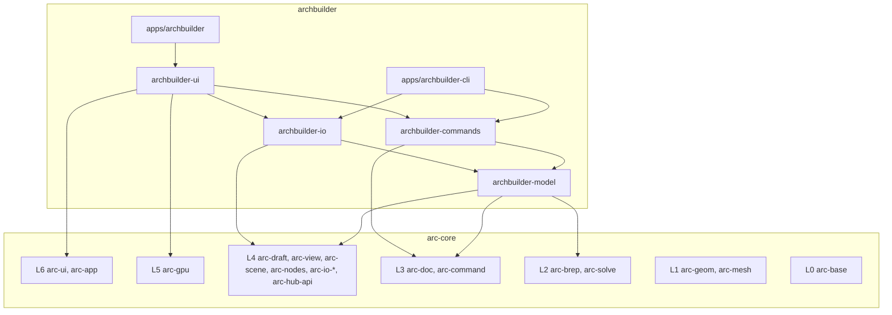
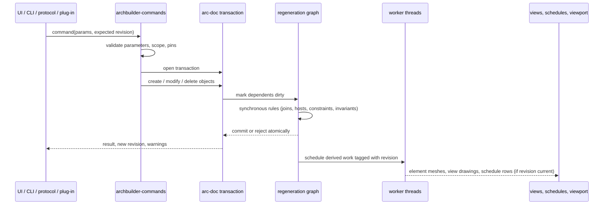

# Architecture overview

This document describes the crates of this repository, how they use `arc-core`, the runtime flows
from command to views, the product-specific subsystems, threading, performance targets, the
automation surface and the testing strategy. Suite-wide decisions are in the
[suite ADRs](https://github.com/ACKaraca/arc-suite/tree/main/docs/adr) and are not repeated here.

## Crates

| Crate | Layer role | Responsibility |
|---|---|---|
| `archbuilder-model` | Headless domain (above `arc-doc`) | Object types of [domain-model.md](domain-model.md), invariants, family definitions and evaluation, element geometry generation, joins, room and area computation, quantity rules, view definitions and the view-generation inputs, warning rules, regeneration graph nodes. Organized in modules per discipline (architecture, structure, services, steel, massing) |
| `archbuilder-commands` | Headless | User-level commands with parameter schemas and interactive prompt machines: placement, modify, family editing, views, annotation, sheets, schedules, phases, options, groups, links, numbering, checks |
| `archbuilder-io` | Headless | Mapping between the domain model and the neutral models of `arc-io-*` crates: IFC, IDS, BCF, DWG/DXF, PDF, glTF, OBJ, STL, OpenUSD, STEP, 3DM and other open-reader formats, LandXML, point clouds, gbXML, COBie, CSV/XLSX, the Arc exchange package; loss reports and identity maps. Built so far: the IFC4 export of walls, doors, windows and floors (rooms are named in the loss report) ([domain-model.md](domain-model.md)) |
| `archbuilder-ui` | UI (egui) | Tools, panels, property grid bindings, viewport interaction, family editor workspace, schedule and sheet editors |
| `apps/archbuilder` | Application | Desktop application wiring: shell, plug-in host, settings. Browser and tablet builds compile the same crates for WebAssembly, iOS and Android with a touch layout in `archbuilder-ui` ([31-web-and-tablet.md](../product/capabilities/31-web-and-tablet.md)); connectors for other applications live in the separate `arc-connectors` repository and exchange only through the package |
| `apps/archbuilder-cli` | Application | Headless CLI: convert, validate, check, publish, compare, canonical text, run scripts and commands, serve the automation protocol |

No other crate exists at the start. A crate is split out when a second concrete user appears:
discipline solvers (structural analysis exchange, duct and pipe sizing) move to their own crate
when they are needed by both the model and a Hub worker independently of the full model; the family
evaluator moves to `archbuilder-family` if DraftBuilder or another product needs to evaluate
ArchBuilder families without the model.

## Use of `arc-core`

| Crate | Used for |
|---|---|
| `arc-base` | Element identifiers, typed quantities and units, tolerances, error types |
| `arc-geom` | Profiles and regions, line and arc carriers, plane clipping for roofs, polyhedral solids for walls, floors and roofs, triangulation, TIN terrain, spatial indexes for picking and room detection |
| `arc-mesh` | Imported meshes, mesh booleans for context and generic elements, tessellation output |
| `arc-brep` | Exact solids for family forms (blends, sweeps, revolves), STEP exchange, solids that require general booleans |
| `arc-solve` | Project constraints, family sketch constraints, the expression and parameter engine |
| `arc-doc` | Typed object tables, stable IDs, transactions, operation journal, dependency graph and scheduler, document package, external references, schema migration |
| `arc-command` | Command registry, parameter schemas, prompt machines, macro recording, automation protocol endpoint, headless runner |
| `arc-draft` | Detail layers, drafting views, detached drawings, annotation entities, sheets, plot styles |
| `arc-view` | Plan, section and elevation projection, hidden-line removal, cut patterns producing `arc-draft` geometry |
| `arc-scene` | Materials appearance, render scene export to RenderBuilder |
| `arc-nodes` | Node graphs for design, family recipes and event rules |
| `arc-io-*` | IFC, DXF, DWG, STEP, mesh, USD, point cloud, geo, PDF, BCF and exchange package neutral models, and readers for formats with an open reader |
| `arc-hub-api` | Hub versions, locks, issues, packages, change sets |
| `arc-gpu`, `arc-ui`, `arc-app` | Viewport, widgets, shell, localization, crash reporting, plug-in loading, assistant panel |

## Runtime flow

1. A command validates its parameters and the expected document revision, then opens a transaction.
2. Element records change. The regeneration graph marks dependents dirty (see the dependency rules
   in [domain-model.md](domain-model.md)).
3. Rules that decide whether the transaction is valid run before commit: host fit, constraint
   solving, join resolution inputs, roof solve, room enclosure state, schema invariants. A failure
   rejects the whole transaction and the document is unchanged.
4. On commit, the journal records element-level operations and warnings are updated.
5. Derived results that do not affect validity (display meshes, view drawings, schedule rows,
   quantities, render scene updates) are computed on worker threads, tagged with the revision, and
   applied only if that revision is still current.

## Product-specific subsystems

| Subsystem | Location | Summary |
|---|---|---|
| Element generators | `archbuilder-model` | Pure functions from element record, type, hosts and context to solids with per-face provenance (element, layer, source edge) |
| Join resolver | `archbuilder-model` | Computes wall-wall, wall-floor and roof joins by layer priority; outputs trim operations consumed by generators |
| Roof solver | `archbuilder-model` | Weighted straight-skeleton style plane solve for footprints, courtyards and unequal pitches with explicit failure locations; a solve is accepted only when its faces cover the footprint without gaps or overlaps and adjacent faces meet at equal heights, and a configuration that fails is rejected rather than patched with vertical faces |
| Room engine | `archbuilder-model` | Boundary detection from room-bounding elements and separation lines on a spatial index, with openings in bounding walls evaluated as closed at the boundary-rule face so that jamb geometry never makes a room leak; area, perimeter, volume and clear dimensions |
| Family evaluator | `archbuilder-model` | Parameter resolution, expression evaluation, sketch solving, form generation; see [families.md](families.md) |
| View pipeline | `archbuilder-model` with `arc-view` | View definition to drafting geometry; see [views-and-documentation.md](views-and-documentation.md) |
| Quantity rules | `archbuilder-model` | One measurement implementation for schedules, takeoffs and IFC quantity sets |
| Exchange mappers | `archbuilder-io` | Domain to neutral-model mapping with loss reports; see [interoperability.md](interoperability.md) |
| Exchange link engine | `archbuilder-io` | Matches entries by exchange identifier, detects changes by content hash and applies reviewed changes as one transaction |
| Rule checker | `archbuilder-model`, `archbuilder-io` | IDS and rule sets evaluated over the model and over IFC exports |

## Threading and background work

- The user interface thread never waits on regeneration. It applies committed results and shows
  pending state.
- Transaction validation runs on the command thread with a work budget; long validations (large
  group edits, roof solves on big footprints) run on a worker against an immutable snapshot and
  commit only if the revision is unchanged.
- Derived work is partitioned per element and per view and runs on a work-stealing pool. Every job
  is cancellable and carries its source revision; stale results are discarded.
- Imports and exports run on workers against a frozen revision and report progress; cancellation
  never leaves a partial file presented as complete.
- The automation protocol serves requests on its own thread and queues commands through the same
  command path.

## Performance targets

Targets are acceptance criteria measured on housing fixture A and on a synthetic large fixture
(about 250,000 elements) on a stated reference machine (OQ-07).

| Target | Value | Rationale |
|---|---|---|
| Interactive edit of one wall, door or floor | Committed and visible in the active view within 100 ms | Editing feels direct only below roughly a tenth of a second |
| Level elevation change affecting a whole storey | Committed within 1 s; all open views current within 3 s | Storey edits are frequent in early design |
| Viewport navigation | 60 frames per second on fixture A, 30 on the large fixture | GPU-driven rendering with instancing makes this achievable |
| Plan view regeneration after a model change | Under 1 s for a typical housing storey | Plans are the most used views |
| Opening a document | Usable view within 5 s on the large fixture with partial loading | Partial loading from the package avoids reading every table |
| Publishing a 100-sheet PDF set | Under 2 min, scaling with core count | Views regenerate in parallel |
| Regeneration scaling | At least 70 percent parallel efficiency on 8 cores for full regeneration | Multi-threaded regeneration is a stated product property |

The first housing fixture is measured from the first build onward, on every batch of changes, and the
numbers are recorded, so that a miss is visible long before the milestone exit. The exit criterion
of a milestone is the target as written; changing it requires an ADR.

## Automation surface

| Surface | Built on | Notes |
|---|---|---|
| Commands | `arc-command` registry | Every model change; schemas generated for clients |
| Automation protocol | JSON-RPC over stdio or local socket | Queries, commands with preview, change subscriptions |
| Model Context Protocol endpoint | Derived from the registry | Same permission and preview rules |
| CLI | `apps/archbuilder-cli` | `convert`, `validate`, `check`, `publish`, `diff`, `text`, `run`, `serve` |
| Python | Official protocol client | Out of process |
| Node graphs | `arc-nodes` | Stored in documents; family recipes use a restricted node set |
| Plug-ins | Sandboxed WebAssembly | Capability manifest, resource limits, transactional application |

## Testing strategy

- **Generator tests:** each element generator is tested with property-based inputs for closed,
  non-self-intersecting solids and with fixtures for join, roof and opening cases.
- **Command tests:** every command has tests for validation failures leaving the document unchanged
  and for undo restoring the exact prior state.
- **Reference fixtures:** housing fixtures A and B are built by scripts through the automation
  protocol, so they double as protocol tests; workflows in
  [workflows.md](../product/workflows.md) run as end-to-end tests on them.
- **View snapshots:** plan, section and elevation outputs are compared as drafting geometry with a
  tolerance, not as images.
- **Exchange validation:** IFC exports are validated by an independent reader and IDS checker in CI;
  DWG and DXF exports by an independent reader; PDF by text and scale extraction.
- **Migration tests:** documents from every released format version are kept and opened in CI.
- **Fuzzing:** importers and the document package reader are fuzzed with bounded inputs.
- **Performance tests:** the targets above run on a scheduled job and fail on regression.
