# Views and documentation

This document describes the three editing contexts, the pipeline that turns the model into drafting
geometry for views, how annotations anchor to the model and what happens when an anchor is lost,
and how sheets are assembled and published. Capabilities are specified in
[10-views-and-graphics.md](../product/capabilities/10-views-and-graphics.md),
[11-annotation-detailing-and-drawings.md](../product/capabilities/11-annotation-detailing-and-drawings.md)
and [13-sheets-and-publishing.md](../product/capabilities/13-sheets-and-publishing.md).

## Three editing contexts

| Context | What it shows | What edits change | Persistence |
|---|---|---|---|
| Linked model view | The model projected by the view definition, plus the view's detail layer | Picking a projected element and editing it runs a model command; the change appears in every view | The view definition is a record; the drawing is derived |
| View detail layer | Drafting entities and annotations drawn over one model view | Only the detail layer; never the model | Stored with the view, separately from model elements |
| Detached drawing | A copy of a view's projection and selected detail items as independent drafting entities | Only the drawing; never the model | A drafting document recording source view and revision |

Rules (see [ADR 0001](../adr/0001-three-editing-contexts.md)):

1. The active context is always visible in the interface, and selection is routed by context: a
   projected model element goes to a model command, a drafting entity to a drafting command. A
   command batch never mixes model and drafting targets.
2. Projected model geometry in a linked view is not editable as lines. Trimming a wall's projected
   line is not an operation; changing the wall is.
3. A detached drawing is created by an explicit command. It receives new identifiers, records the
   source view, its effective settings and the document revision, and has no dependency on the
   model. Model changes never alter it. Its source-changed indicator compares the recorded revision
   with the current projection on request.
4. Converting drafting lines into model elements is an explicit command (AB-ANNO-026) that creates
   new model elements and leaves the drafting entities untouched.
5. Outputs of all three contexts can be placed on the same sheet.

## View-generation pipeline

```mermaid
flowchart LR
  A[View definition and settings] --> B[Element selection]
  B --> C[Visibility resolution]
  C --> D[Solid retrieval]
  D --> E[Clip and cut]
  E --> F[Hidden-line classification]
  F --> G[Graphic resolution]
  G --> H[Drafting geometry]
  H --> I[Detail layer overlay]
  I --> J[Viewport and output]
```

| Stage | Work | Owner |
|---|---|---|
| View definition | Resolve the view's effective settings: template-controlled values first, then parent view values for child views, then the view's own values | `archbuilder-model` |
| Element selection | Spatial index query by the view's range, plane and depth or camera frustum and section volume; include links per link display settings | `archbuilder-model` |
| Visibility resolution | Phase and display rule, design option, category visibility, filters in order, temporary hide or isolate, discipline, detail level, family visibility conditions | `archbuilder-model` |
| Solid retrieval | Element solids with face provenance from the regeneration cache at the view's revision; family symbolic geometry for the view orientation | `archbuilder-model` |
| Clip and cut | Clip by range or depth; intersect with the cut plane to produce cut regions per element, material and layer; apply crop | `arc-view` |
| Hidden-line classification | Classify projected edges as visible, hidden or beyond, with planar and analytic surfaces exact and tessellated surfaces within a stated tolerance | `arc-view` |
| Graphic resolution | Apply object styles, overrides, filters, cut patterns from materials, halftone and line weights for the view scale | `archbuilder-model` |
| Drafting geometry | Emit `arc-draft` entities carrying source element, face role and layer provenance and the revision | `arc-view` |
| Detail layer overlay | Resolve annotation anchors and values against the same revision; draw detail entities | `archbuilder-model`, `arc-draft` |
| Output | Display in the viewport, place in viewports, publish | `arc-gpu`, `arc-draft`, `arc-io-pdf`, `arc-io-dwg` |

Properties of the pipeline:

- Each view's drawing is a derived product in the dependency graph. It is computed on workers,
  partitioned by element, and assembled per view; per-element results are reused across views that
  share a cut plane or projection direction.
- Every drawing carries the revision it was computed from. Interactive views show a pending state
  while a newer revision is computing; publishing waits for every viewport of the set to reach the
  same revision.
- Hidden categories still participate in host cuts, joins and room boundaries; they are removed
  from drawing and occlusion only.
- Provenance on drafting entities is what makes picking, live dimensions and annotation anchors work
  in 2D views.

## Model views as implemented

Plan views (`archbuilder.plan_view`) and model views (`archbuilder.model_view`) are records of
authored settings; their drawings are derived on the extraction workers and never stored.

- **Saved 3D views** keep a camera (eye, target, perspective or orthographic, field of view), a
  visual style, a section box and the visibility of a plan view (category flags and the elements
  hidden in the view). Opening one sets its camera; New 3D view and Save camera store the
  viewport's camera. The visual styles are the shading modes of the `arc-gpu` renderer: wireframe,
  hidden line, shaded, shaded with edges and consistent colors; the default 3D view keeps its style
  for the session. The section box is the renderer's axis-aligned box (switched on without corners it takes the
  extent of the walls): it clips meshes and caps closed solids, not line items. Textures, shadows, ambient occlusion and sun are not provided.
- **Sections** are a line in plan (they look to the left of start to end) with a far clip
  distance; **elevations** are made four per building, each line 5 m outside the extent of its
  walls and facing it. Both are drawn by `arc-view` in an orthographic frame through the line
  (view x along the line, view y the elevation): what the cut plane crosses is cut, what lies
  within the far clip behind it is beyond, what lies in front is not drawn. With crop on, the
  drawing is cropped to the line and, when set, between the bottom and top elevations. The drawing
  stands in the vertical plane of the line and the camera faces it with rotation locked. Levels
  (line, name and elevation) and the grids the line crosses (line and head) are drawn over it.
  Plan symbols, rooms and railings by path are not drawn in sections yet; the extent of a level is
  the width of the view.
- **Markers**: the plan views of a building draw its sections (line and a triangle at each end
  pointing where the section looks) and elevations (a circle with a triangle toward the building).
- **North**: a plan view oriented to true north is framed turned by the true north angle, so true
  north points up.
- The project browser lists the 3D view, the plan views, then the saved 3D views, sections and
  elevations; each opens in the viewport, and the property grid shows its settings while nothing is
  selected.

## Annotation anchoring

| Anchor kind | Resolves to | Example |
|---|---|---|
| Element role | An element and a semantic role (center, location line, insertion point) | Tag of a door; dimension to a wall centerline |
| Persistent face or edge reference | An element, a generator face role and source edge (see identity rules in [domain-model.md](domain-model.md)) | Dimension to a wall's exterior finish face |
| Datum | A grid, level or reference plane | Dimension between grids |
| Linked element | A link instance plus a linked element ID and role | Tag of a consultant's column |
| View coordinate | A point in the view plane | Text note without a leader target |
| Drafting entity | A drafting entity and grip in the same detail layer or drafting document | Dimension to a detail line |

Resolution runs after each regeneration for every annotation in open views, and for all views
before publishing. A resolved anchor updates the annotation's geometry and value. Dimension values
always derive from resolved geometry; replacement text is a visible override and does not change
geometry.

## Orphan handling

1. An anchor that no longer resolves (element deleted, face role no longer produced, link unloaded,
   linked element removed) sets the annotation state to orphaned.
2. An orphaned annotation keeps its last resolved position and is drawn with an orphan marker in
   interactive views; its measured value is shown as unavailable rather than as the last value.
3. Orphaned annotations are listed in the warnings register. Publishing reports them; a publish
   profile can block publishing while orphans exist.
4. Reattachment is an explicit command that picks a new anchor. No automatic rule rebinds an anchor
   to a nearby face or element, because a dimension bound to the wrong face looks trustworthy and is
   not.
5. Undoing the change that orphaned an annotation restores the original anchor and state.

## Sheets

- Sheets are drafting layouts in paper millimeters using `arc-draft`, the same layout and plot model
  as DraftBuilder.
- A viewport references a model view, drafting view, detached drawing, legend or schedule, with paper
  position, rotation and type. The view's scale sets the viewport scale.
- Title blocks are annotation families whose labels read project, sheet and revision parameters.
- Revision tables combine revision clouds found in viewports on the sheet with manual assignments.
- Publishing freezes one document revision, waits for all affected views to reach it, renders each
  sheet's viewports from that revision, writes the output through the format crate, validates it,
  and records a publication record (revision, sheets, files, checksums). A model change during
  publishing does not alter the frozen output.
